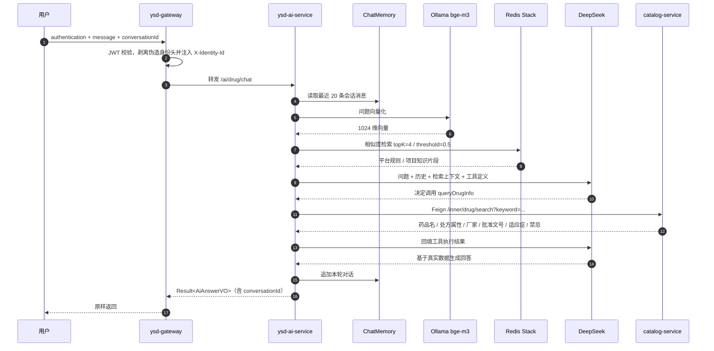
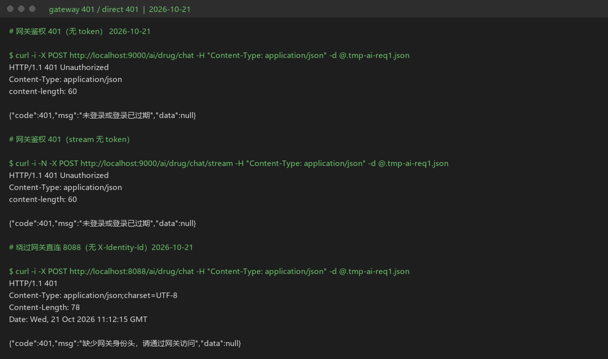
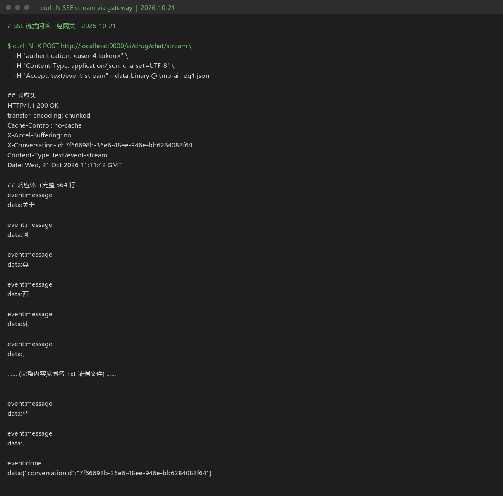
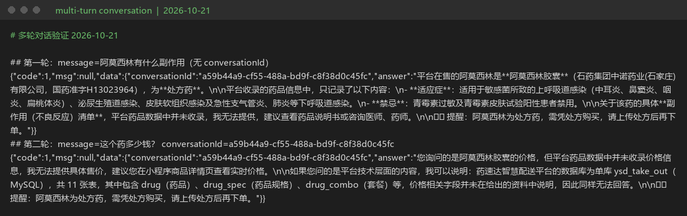
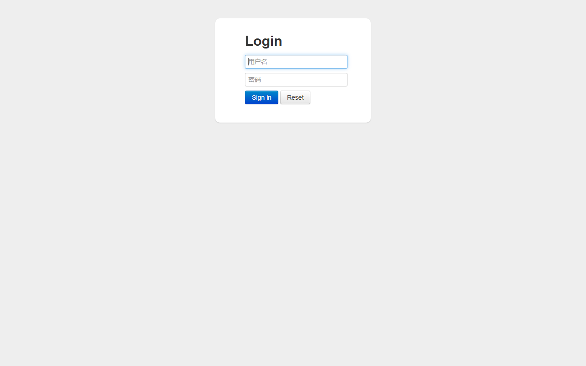

# 药速达（ysd-take-out）—— 基于 Spring Cloud + Spring AI 的医药即时配送平台

> 药速达是一个面向**医药即时零售与同城即时配送**场景的平台：管理端负责药品目录、订单履约与运营统计，
> 用户端提供药品浏览、购物车、下单与订单跟踪；平台侧通过 **Spring Cloud** 完成服务治理，通过 **Spring AI**
> 提供药品查询、用药咨询、规则检索与处方药合规审核能力。


简体中文 | *[English](./README_EN.md)*

---

## 目录

- [项目亮点](#项目亮点)
- [系统架构](#系统架构)
- [AI Agent 链路](#ai-agent-链路)
- [技术栈](#技术栈)
- [工程结构](#工程结构)
- [快速启动](#快速启动)
- [AI 接口体验](#ai-接口体验)
- [演示与证据截图](#演示与证据截图)
- [当前状态与边界](#当前状态与边界)
- [文档导航](#文档导航)
- [致谢](#致谢)
- [License](#license)

---

## 项目亮点

### 1. 药品业务建模与数据设计

**业务场景**：医药即时配送的商品信息既要支撑选购与下单，又要承载强监管字段（处方属性、批准文号、
适应症、禁忌），还要被 AI 用药咨询与合规审核复用。

**实现方案**：按「分类 → 药品 → 规格 → 药品组合」建立领域模型，并让数据库、Java 实体、REST/Feign
接口与 Redis 缓存共用同一套药品语义：

| 业务对象 | 表 / 实体 | 关键字段 | 当前用途 |
|---|---|---|---|
| 药品分类 | `category` | 名称、类型、排序、状态 | 管理端维护、用户端分类浏览 |
| 药品 | `drug` / `Drug` | 名称、价格、图片、描述、上下架状态 | 目录展示、加购时取快照 |
| 药品规格 | `drug_spec` / `DrugSpec` | 规格名称、规格取值列表 | 同一药品的包装 / 剂量选择 |
| 药品组合 | `drug_combo` + `drug_combo_item` | 组合名称、组合价、包含药品与数量 | 打包销售与组合价维护 |

在通用商品属性之外，药品实体补充了医药场景必需的结构化字段：
`prescription_type`（0 = OTC 非处方药 / 1 = 处方药）、`manufacturer`（生产厂家）、
`approval_number`（批准文号）、`indications`（适应症）、`contraindications`（禁忌）。
这些字段在 `Drug`、`DrugDTO`/`DrugVO`、跨服务传输的 `DrugInfoDTO` 与 `/inner/drug/**` 内部接口中保持一致，
使选购、下单与 AI 共用同一份药品事实。缓存同样按药品维度组织：
`ysd:catalog:drug:{categoryId}`、`ysd:catalog:combo:{categoryId}`、`ysd:catalog:category:{type}`。

**处方属性与购买合规**：`prescription_type` 是两条链路的共同判据。

- **下单链路（同步、确定性）**：`order-service` 在写订单前调用
  `POST /inner/ai/check-prescription`。`PrescriptionAuditService` 先按药品 ID 取处方属性，
  购物车不含处方药直接放行；含处方药时必须携带处方凭证，否则拦截。
  药品查询失败、审核服务超时或熔断一律拒绝下单（fail-closed），不做“先放行后补审”。
- **咨询链路（RAG + 生成）**：`GET /ai/prescription/check` 先查药品事实，OTC 直接返回可购买；
  处方药则检索平台《处方药购买规则》并生成审核通知。检索为空时直接返回错误、不调用模型——
  没有依据的生成只能是编造。

**验证**：字段、接口与两条链路均在源码中落地；下单链路的拒单、超时与宕机分支由
`OrderPrescriptionAuditTest` 与 [T31 AI 失败路径测试](docs/05-测试与压测/T31-AI失败路径测试记录.md) 覆盖。

### 2. 智能 Agent：Tool Calling + RAG + ChatMemory

`ysd-ai-service` 基于 **Spring AI 1.1.8** 构建，把药品事实、平台规则与大模型生成组合在一起：

- **Tool Calling**：`DrugQueryTool` 通过 `@Tool` 暴露药品查询能力，模型自主决定是否调用，
  再经 Feign 访问 `catalog-service` 的 `/inner/drug/search`；适应症、禁忌、处方属性等事实以工具返回为准。
- **RAG**：8 份医药业务知识文档（处方药购买规则、OTC 与处方药分类、用药禁忌与相互作用、
  特殊人群用药、储存与冷链等）经 `TokenTextSplitter` 切分，由本地 **Ollama bge-m3** 向量化，
  写入 **Redis Stack** 向量索引 `ysd_rag_idx`；`QuestionAnswerAdvisor` 以 `topK=4`、相似度阈值 `0.5`
  检索平台规则。
- **ChatMemory**：`MessageWindowChatMemory` 保留最近 20 条消息，记忆键按「用户 + conversationId」
  隔离，跨用户复用同一会话 ID 也读不到对方历史。
- **确定性编排**：处方药审核接口不使用“让模型自行规划”的方式，而是由 Java 代码固定执行
  “查药品 → 判断处方属性 → RAG 检索规则 → 生成审核通知”，保证严肃业务的执行顺序与结果确定性。
- **安全护栏**：系统提示词要求工具与文档没有的信息不得编造；处方药必须提示上传处方；
  接口接入 Sentinel 限流，防止刷取导致 Token 消耗失控；空输入与超长输入在进入模型前即被拒绝。

**验证**：T31 覆盖空输入、工具异常、RAG 空召回、跨用户记忆隔离与处方审核 fail-closed；RAG 侧另有 20 题离线评测
（[检索设计与评测](docs/02-架构设计与开发/AI-RAG检索设计与评测.md)）。

### 3. 微服务治理

- **Nacos**：服务注册发现、配置中心、Sentinel 网关流控规则持久化；
- **Gateway**：7 条业务路由统一入口，JWT 校验后注入 `X-Identity-Id`；路由前无条件剥离客户端
  伪造的同名头，服务端拦截器再兜底一层，兼容绕过网关的直连场景；
- **OpenFeign**：跨服务只读调用 + `fallbackFactory` 降级；`/inner/**` 内部接口不经网关暴露，
  AI 服务对 catalog 单独配置 1s 连接 / 2s 读取超时，依赖不可用时快速失败；
- **Sentinel**：网关 `gw-flow` 限流 + AI 接口方法级 `@SentinelResource` 资源限流；
- **Zipkin + Micrometer Tracing**：网关与业务服务统一 traceId 日志格式，支持全链路追踪；
- **ShedLock**：订单超时关闭、派送完成两个定时任务使用 Redis 分布式锁，避免多实例重复执行；
- **RabbitMQ + WebSocket**：来单提醒、催单等消息经 fanout 交换机广播，各推送实例独立消费。

### 4. 数据一致性、缓存与并发安全

- **10 万条药品数据**保留为长期压测基线，覆盖分页、缓存与索引验证；
- **并发重复加购**：JMeter 50 并发复现出 50 条重复购物车行，新增
  `shopping_cart.uk_user_drug (user_id, drug_id)` 从数据库层兜住重复写入，同压测条件下
  `COUNT(*) = 1`（T22 复现 → 修复 → 回归）；
- **缓存防护**：空值缓存防穿透、本地互斥锁防击穿、TTL 随机偏移防雪崩；写操作提交后延迟双删，
  失效统一走 `SCAN` 而非 `KEYS`，避免阻塞 Redis；
- **锁与死锁演练**：T08/T09 用双会话复现锁等待，借 `SHOW ENGINE INNODB STATUS` 定位等待链并沉淀排查 SQL；
- **索引优化**：补充 `(category_id, status, create_time)` 复合索引消除 index_merge 与 filesort
  （89 ms → 34 ms），把低基数 `idx_drug_status` 设为 INVISIBLE 让模糊查询回到全表扫描；
- **连接池观测**：压测期间采集 Druid 活跃连接、等待线程与慢 SQL，形成可复现证据（T06）；
- 相关 SQL 与结论见 `docs/04-运维与故障排查/003_database_optimization_and_fixes.sql` 与
  [docs/portfolio/01-database/](docs/portfolio/01-database/)。

### 5. 容器化一键部署

提供多阶段构建的通用 `Dockerfile`（`MODULE` 构建参数复用给任意微服务）与 `docker-compose.yml`：

- 一条命令拉起 **Nacos 3 + MySQL 8 + Redis Stack + catalog-service + ai-service**；
- MySQL 首次创建数据卷时自动执行建表脚本；
- Nacos 3.x 鉴权初始化由一次性容器自动完成；
- 所有敏感配置通过根目录 `.env` 注入，`.env` 已被 `.gitignore` 排除；
- 容器健康检查、启动依赖顺序、非 root 运行均已配置。

> 通用 Dockerfile 支持 `--build-arg MODULE=ysd-order-service` 等方式构建其余业务服务镜像；
> 当前 Compose 只编排了基础设施与 catalog / AI 两个核心服务，详见[当前状态与边界](#当前状态与边界)。

### 6. 可复现的测试与排障证据

- **压测与故障演练**：JMeter 计划覆盖缓存命中 / 穿透 / 延迟双删、Feign 熔断、网关限流、
  连接池耗尽、并发加购与 MQ 行为观察；
- **安全**：T26 复现水平越权（IDOR）→ 修复 → 回归，越权请求返回无权限、订单数不变；
- **AI 失败路径**：T31 覆盖空输入、工具异常、RAG 空召回、跨用户记忆隔离与处方审核 fail-closed；
- **RAG 评测**：20 题自建评测集，15 道可回答题 Hit Rate@4 = 100%，并验证阈值 0.8 会掉到 13/15；
- 原始输出与截图统一索引在 [docs/portfolio/README.md](docs/portfolio/README.md)，可逐条回溯到
  对应测试记录。

---

## 系统架构

```mermaid
flowchart TB
    subgraph CLIENT[客户端]
        WEB[管理端 Web]
        MP[微信小程序]
    end

    WEB --> GW
    MP --> GW

    GW["ysd-gateway :9000<br/>JWT 鉴权 · 路由转发 · Sentinel 网关限流"]

    subgraph SVC[业务微服务 · Nacos 注册发现]
        ADMIN["ysd-admin-service :8082<br/>员工 / 店铺 / 文件"]
        USER["ysd-user-service :8081<br/>用户 / 地址簿"]
        CATALOG["ysd-catalog-service :8084<br/>分类 / 药品 / 药品组合"]
        ORDER["ysd-order-service :8085<br/>购物车 / 订单 / 支付回调"]
        REPORT["ysd-report-service :8083<br/>统计 / 报表"]
        PUSH["ysd-push-service :8086<br/>WebSocket / MQ 推送"]
        AI["ysd-ai-service :8088<br/>AI Agent"]
    end

    GW --> ADMIN
    GW --> USER
    GW --> CATALOG
    GW --> ORDER
    GW --> REPORT
    GW -. "ws://.../ws/{sid}" .-> PUSH

    AI -->|"Tool Calling: Feign /inner/drug/**"| CATALOG

    subgraph AGENT[AI Agent 内部链路]
        TOOL[DrugQueryTool<br/>@Tool 药品查询]
        CHAT[ChatClient<br/>DeepSeek deepseek-chat]
        MEM[MessageWindowChatMemory<br/>20 条窗口记忆]
        RAG[QuestionAnswerAdvisor<br/>RAG 检索]
        VEC[(Redis Stack<br/>ysd_rag_idx 向量索引)]
        EMB[Ollama bge-m3<br/>1024 维 Embedding]
        PRESET[处方药审核<br/>Java 固定步骤编排]
    end

    AI --> TOOL
    AI --> CHAT
    AI --> MEM
    AI --> RAG
    AI --> PRESET
    RAG --> VEC
    VEC -.->|"文档向量化"| EMB

    subgraph INFRA[基础设施]
        NACOS[(Nacos 3.0.3<br/>注册 / 配置 / 流控规则)]
        MYSQL[(MySQL 8.0<br/>ysd_take_out)]
        REDIS[(Redis Stack<br/>业务缓存 db10 / 向量 db0)]
        MQ[(RabbitMQ<br/>异步推送)]
        ZIPKIN[(Zipkin<br/>链路追踪)]
    end

    SVC -.-> INFRA
```

**架构说明**

- 前端与管理端统一经网关 `:9000` 进入，网关按业务前缀路由到对应服务；
- `ysd-ai-service` 已纳入网关 `/ai/**` 路由，必须携带用户端 `authentication` 头；
  服务自身校验网关注入的 `X-Identity-Id`，拒绝绕过网关的直连请求；
- 微服务已按业务域拆分，但仍处于**共享数据库 `ysd_take_out` + 共享 Redis db10** 的过渡架构，
  尚未做数据库垂直拆分；这是有意的阶段性取舍，便于逐步迁移与对照验证；
- AI 的向量数据写入 Redis Stack 的 **db0**，以 `ysd:rag:` 前缀与业务缓存隔离。

---

## AI Agent 链路

以 `POST /ai/drug/chat` 为例（除流式接口外，链路一致）：



处方药审核链路（`GET /ai/prescription/check`）刻意不交给模型规划：

```text
drugName
  → catalog-service 查询药品
  → prescription_type == 1 ?
      ├─ 否：直接返回 OTC 可购买
      └─ 是：RAG 检索处方药购买规则
             → 药品数据 + 规则上下文 + 固定 Prompt
             → 生成合规审核通知
```

> 下单链路的处方审核是另一条链路：`order-service` 调用内网 `POST /inner/ai/check-prescription`，
> 由 `PrescriptionAuditService` 只做确定性判断（是否含处方药、是否带处方凭证），不调用模型，
> 以满足下单接口的同步耗时要求；任何异常都按 fail-closed 拦截。

---

## 技术栈

| 分类 | 技术 | 版本 |
|---|---|---|
| 语言 / 运行时 | Java | 21 |
| 基础框架 | Spring Boot | 3.5.16 |
| 微服务 | Spring Cloud | 2025.0.0 |
| 微服务（阿里） | Spring Cloud Alibaba | 2025.0.0.0 |
| AI | Spring AI | 1.1.8 |
| 大模型 | DeepSeek `deepseek-chat`（OpenAI 兼容协议） | — |
| Embedding | Ollama `bge-m3`（1024 维） | — |
| 向量库 | Redis Stack / RediSearch | latest |
| 注册 / 配置中心 | Nacos | 3.0.3 |
| 网关 | Spring Cloud Gateway（WebFlux） | 随 Spring Cloud 2025.0.x |
| 流控 | Sentinel | 随 Spring Cloud Alibaba 2025.0.x |
| 链路追踪 | Micrometer Tracing + Brave + Zipkin | 随 Spring Boot BOM |
| 持久层 | MyBatis Spring Boot Starter / PageHelper | 3.0.5 / 2.1.1 |
| 连接池 | Druid（`druid-spring-boot-3-starter`） | 1.2.28 |
| 数据库 | MySQL | 8.x |
| 缓存 | Redis / Spring Data Redis（Lettuce） | — |
| 消息 | RabbitMQ | — |
| 分布式任务锁 | ShedLock | 6.9.0 |
| 鉴权 | JJWT | 0.12.6 |
| 接口文档 | knife4j / springdoc-openapi | 4.5.0 / 2.8.17 |
| Excel | Apache POI | 5.5.1 |
| 对象存储 | 阿里云 OSS SDK | 3.18.5 |
| 支付 | wechatpay-apache-httpclient | 0.6.0 |

---

## 工程结构

```text
ysd-take-out/
├── ysd-common/              # 统一返回 Result、异常体系、JWT、ThreadLocal 上下文
├── ysd-pojo/                # entity / dto / vo
├── ysd-api/                 # 跨服务契约：Feign 客户端 + DTO
├── ysd-gateway/             # 网关 :9000（路由 + JWT 鉴权 + Sentinel）
├── ysd-user-service/        # 用户服务 :8081（用户 / 地址簿）
├── ysd-admin-service/       # 管理服务 :8082（员工 / 店铺 / 文件）
├── ysd-report-service/      # 报表服务 :8083（统计 / Excel 导出）
├── ysd-catalog-service/     # 目录服务 :8084（分类 / 药品 / 药品组合）
├── ysd-order-service/       # 订单服务 :8085（购物车 / 订单 / 支付回调 / 定时任务）
├── ysd-push-service/        # 推送服务 :8086（WebSocket / RabbitMQ）
├── ysd-ai-service/          # AI 服务 :8088（Agent / RAG / ChatMemory）
├── ysd-admin-web/           # 管理端前端（Vue 2 + TS + Element UI）
├── ysd-miniapp/             # 用户端小程序（当前开源发布包未包含，授权待确认）
├── docker/mysql/init/       # MySQL 首次启动自动建表
├── docker/nginx/            # 管理端 Nginx 反代示例
├── scripts/                 # 开源导出脚本（一键启停见根目录 start-all.sh / stop-all.sh）
├── docker-compose.yml       # 基础设施 + catalog + AI 一键编排
├── Dockerfile               # 多阶段构建，MODULE 参数复用
├── SECURITY.md              # 安全策略与部署加固清单
├── CONTRIBUTING.md          # 贡献指南
└── docs/                    # 架构、源码学习、运维排障、测试与作品集
```

**端口一览**

| 组件 | 端口 | 说明 |
|---|---|---|
| ysd-gateway | 9000 | 统一业务入口 |
| ysd-user-service | 8081 | 用户 / 地址簿 |
| ysd-admin-service | 8082 | 员工 / 店铺 / 文件 |
| ysd-report-service | 8083 | 运营统计 / 报表 |
| ysd-catalog-service | 8084 | 分类 / 药品 / 药品组合 |
| ysd-order-service | 8085 | 购物车 / 订单 / 支付回调 |
| ysd-push-service | 8086 | WebSocket / MQ |
| ysd-ai-service | 8088 | AI Agent（经网关 `/ai/**`，直连返回 401） |
| Nacos | 8848 / 9848 | 客户端 API / gRPC |
| Nacos 控制台 | 8849 | Compose 映射，避开本机 8080 |
| MySQL | 3307 | Compose 映射，避开本机 3306 |
| Redis Stack | 6379 | 业务缓存 db10 / 向量 db0 |
| Zipkin | 9411 | Compose 未内置，可按需启动 |

---

## 快速启动

### 前置条件

| 依赖 | 要求 |
|---|---|
| Docker | Docker Desktop / Docker Engine |
| Docker Compose | v2（使用 `docker compose` 命令） |
| 内存 | 建议 ≥ 8 GB（Nacos + MySQL + Redis + 两个 Java 服务） |
| Ollama | 仅 AI 服务需要；宿主机监听 `0.0.0.0:18434`，并已 `ollama pull bge-m3` |
| DeepSeek API Key | 仅 AI 对话需要；不填不影响其余服务启动 |

### 1. 配置 `.env`

```bash
cp .env.example .env
```

Windows 也可直接复制文件：

```powershell
Copy-Item .env.example .env
```

编辑 `.env`，**Compose 启动必须填写以下变量**：

```dotenv
# MySQL
MYSQL_ROOT_PASSWORD=your-strong-root-password
MYSQL_USERNAME=root
MYSQL_PASSWORD=your-strong-root-password

# Nacos 3.x 鉴权
# 先用 `openssl rand -base64 32` 生成，再把输出粘贴到等号右侧
NACOS_AUTH_TOKEN=paste-base64-random-32-bytes-here
NACOS_ADMIN_PASSWORD=your-nacos-password
NACOS_USERNAME=nacos
NACOS_PASSWORD=your-nacos-password

# AI（可选；不填则 AI 对话失败，但服务仍可启动）
DEEPSEEK_API_KEY=sk-xxxxxxxxxxxxxxxx
```

注意事项：

- `NACOS_AUTH_TOKEN` 必须是 Base64，解码后不少于 32 字节；`.env` 不会执行 shell 命令，
  请先运行 `openssl rand -base64 32`，再把结果粘贴进去；
- `NACOS_ADMIN_PASSWORD` 与 `NACOS_PASSWORD` 请保持一致：前者用于初始化 `nacos` 管理员，
  后者供各服务注册与拉取配置时登录；
- `.env` 已被 `.gitignore` 排除，**不要提交真实密钥**；
- 如需使用镜像加速，可在 `.env` 中取消注释并设置 `MAVEN_IMAGE` / `JRE_IMAGE` / `REDIS_IMAGE`。

### 2. 准备 Ollama（AI 服务必需）

Docker 容器需要访问宿主机上的 Ollama：

```bash
# 1) 让 Ollama 监听所有网卡（Windows 设置后需重启 Ollama）
#    Windows:
setx OLLAMA_HOST 0.0.0.0:18434
#    Linux:
OLLAMA_HOST=0.0.0.0:18434 ollama serve

# 2) 拉取向量模型
ollama pull bge-m3
```

> Compose 会把 `OLLAMA_BASE_URL` 注入为 `http://host.docker.internal:18434`。
> 不需要 AI 服务时，可单独启动基础设施与 catalog：`docker compose up -d nacos nacos-init mysql redis ysd-catalog-service`。

### 3. 一键启动

```bash
docker compose up -d
```

首次启动会构建 `ysd-catalog-service` 与 `ysd-ai-service` 镜像，耗时取决于网络与依赖缓存。
查看状态与日志：

```bash
docker compose ps
docker compose logs -f ysd-catalog-service
docker compose logs -f ysd-ai-service
```

典型启动顺序由 `depends_on` 与健康检查控制：

```text
Nacos → nacos-init → MySQL / Redis → catalog-service → ai-service
```

### 4. 验证

| 入口 | 地址 |
|---|---|
| Nacos 控制台 | http://localhost:8849 （用户名 `nacos`，密码为 `NACOS_ADMIN_PASSWORD`） |
| catalog 健康检查 | http://localhost:8084/actuator/health |
| catalog 接口文档 | http://localhost:8084/doc.html |
| AI 健康检查 | http://localhost:8088/actuator/health |
| MySQL | `127.0.0.1:3307`，库 `ysd_take_out` |
| Redis Stack | `127.0.0.1:6379` |

MySQL 首次创建数据卷时会自动执行 `docker/mysql/init/01-schema.sql` 建表。
若需清空数据并重新初始化：

```bash
docker compose down -v
docker compose up -d
```

### 5. 启动其余业务服务（本机 Maven）

当前 Compose 未编排 gateway / user / admin / report / order / push。可本机启动：

```bash
# 根目录编译
mvn clean install -DskipTests

# 按需启动（Nacos 已由 Compose 提供，默认连接 127.0.0.1:8848）
mvn -pl ysd-user-service    spring-boot:run
mvn -pl ysd-admin-service   spring-boot:run
mvn -pl ysd-report-service  spring-boot:run
mvn -pl ysd-order-service   spring-boot:run
mvn -pl ysd-push-service    spring-boot:run

# 最后启动网关 :9000
mvn -pl ysd-gateway spring-boot:run
```

#### 方式 B：`start-all.sh`（本机全量启动）

适合已经装好 JDK 21 / Maven、且中间件已在本机运行的开发环境：

```bash
# 首次或代码变更后：构建全部模块（跳过测试）
./start-all.sh --build

# 日常启动：复用 target 下的 jar，自动跳过已在运行的服务
./start-all.sh

# 不需要 AI 时（无 Ollama / DeepSeek Key）
./start-all.sh --no-ai

# 停止全部微服务；加 --infra 可同时停止本机 Docker 中间件
./stop-all.sh
```

脚本会：检查 MySQL / Redis / Nacos / RabbitMQ 端口（缺失时尝试 `docker start` 同名容器）→
按顺序拉起 user / catalog / order / report / admin / push / ai / gateway → 等待端口就绪，
日志写入 `logs/*.out.log`，PID 写入 `logs/*.pid`。若中间件容器名不同，请先按 README 启动它们。

也可复用通用 Dockerfile 自行扩展 Compose：

```bash
docker build --build-arg MODULE=ysd-order-service -t ysd/ysd-order-service:1.0.0 .
```

> 扩展 Compose 时，容器内还需把 `SPRING_CLOUD_NACOS_DISCOVERY_IP` 设为服务名
> （例如 `ysd-order-service`），否则 `application.yml` 中的 `127.0.0.1` 会被注册到 Nacos，
> 其他服务将无法通过服务名调用它。宿主机本机启动时沿用 `127.0.0.1` 即可。

> 本机启动其余服务时，请确保数据库、Redis、RabbitMQ 等连接信息与 Compose 暴露的端口一致，
> 并通过环境变量注入 JWT 密钥、微信、OSS、AI 等敏感配置。

### 6. 启动管理端前端

需要 Node.js 与 npm。先确保网关已在 `:9000` 启动：

```bash
cd ysd-admin-web
npm install
npm run serve
```

默认访问 `http://localhost:8888`（见 `ysd-admin-web/vue.config.js` 的 `devServer.port`）。
开发服务器把 `/api` 代理到 `.env.development` 中的 `VUE_APP_URL`，默认是
`http://localhost:9000/admin`；WebSocket 默认连 `ws://localhost:9000/ws/`。

> 管理端基于 Vue CLI 3 / Webpack 4，建议使用 Node 16 LTS。Node 24 下已验证会在
> workbox-build 生成 service worker 时失败（`assignWith is not defined`）；`npm ci`
> 也可能因 lock 与 package.json 不一致报错，此时可改用 `npm install`。

### 7. 用户端小程序（当前发布包未包含）

当前开源发布包**不包含** `ysd-miniapp/`：该目录源码的再分发授权尚未确认，
来源与授权状态见 [NOTICE.md](NOTICE.md)。取得权利人的书面许可后，再将其纳入发布并更新 NOTICE。

若你已从授权版本获得该目录，启动方式如下：

1. 使用 HBuilderX 导入 `ysd-miniapp`；
2. 检查 `utils/env.js` 中的 `baseUrl`（本地调试用 `http://localhost:9000`，真机调试改成电脑局域网 IP）；
3. `project.config.json` 中的 `appid` 默认是 `touristappid`，需替换为实际小程序 AppID；
4. 在微信开发者工具中关闭「不校验合法域名」。

### 8. 停止

```bash
docker compose down       # 停止并保留数据卷
docker compose down -v    # 停止并清空 MySQL / Redis / Nacos 数据
```

---

## AI 接口体验

AI 服务已接入网关：请求统一走 `http://localhost:9000/ai/**`，必须携带用户端 JWT（请求头 `authentication`）。
AI 服务自身只接受网关注入的 `X-Identity-Id`，直接访问 `:8088` 会返回 401。

```bash
TOKEN=$(python jmeter/gen-user-token.py 4)
```

### 药品咨询（Tool Calling + RAG + ChatMemory）

阻塞式问答，响应体中的 `conversationId` 供下一轮回传：

```bash
curl -X POST "http://localhost:9000/ai/drug/chat" \
  -H "authentication: $TOKEN" \
  -H "Content-Type: application/json; charset=UTF-8" \
  --data-binary '{"message":"布洛芬有什么禁忌？"}'
```

再次提问时复用同一个 `conversationId`，即可体验多轮记忆：

```bash
curl -X POST "http://localhost:9000/ai/drug/chat" \
  -H "authentication: $TOKEN" \
  -H "Content-Type: application/json; charset=UTF-8" \
  --data-binary '{"message":"那儿童能吃吗？","conversationId":"<上一轮返回的 conversationId>"}'
```

流式问答（SSE）：`message` 为增量文本，`done` 事件携带 `conversationId`，`error` 为错误提示。

```bash
curl -N -X POST "http://localhost:9000/ai/drug/chat/stream" \
  -H "authentication: $TOKEN" \
  -H "Content-Type: application/json; charset=UTF-8" \
  -H "Accept: text/event-stream" \
  --data-binary '{"message":"阿莫西林有什么副作用"}'
```

> Windows Git Bash 下中文请求体可能被转成 GBK，建议把 JSON 存为 UTF-8 文件后用 `--data-binary @file.json` 发送。

### 处方药合规审核

```bash
curl -G "http://localhost:9000/ai/prescription/check" \
  -H "authentication: $TOKEN" \
  --data-urlencode "drugName=阿莫西林"
```

非处方药会直接返回 OTC 提示；处方药会结合药品事实与 RAG 检索到的平台规则生成审核通知。

---

## 演示与证据截图

以下为测试过程中留存的真实截图，完整清单见 [docs/portfolio/README.md](docs/portfolio/README.md)：

### AI 网关鉴权（直连 8088 被拒绝）



### AI 流式回答（SSE 增量输出）



### 多轮对话记忆



### Druid 连接池监控（T06 压测）



> 管理端 / 小程序界面截图待补充；如需替换，请将图片放入 `docs/assets/screenshots/` 并更新本节链接。

---

## 当前状态与边界

为避免“设计目标”与“已落地代码”混淆，明确当前边界：

- 服务已按业务域全部拆分完成：网关 + 7 个业务服务
  （user / admin / report / catalog / order / push / ai），仓库内不再保留单体运行模块；
- 仍采用**共享数据库 + 共享 Redis db10** 的过渡架构，尚未做数据库垂直拆分；
- 订单表保留少量早期字段命名（`tableware_*`），尚未重命名；本次仅整改文档，
  未改动表结构、实体与接口；
- `docker-compose.yml` 当前覆盖 **Nacos / MySQL / Redis Stack / catalog / AI**，
  其余业务服务需本机启动或自行扩展 Compose；
- Compose 未内置 Zipkin 与 RabbitMQ；为便于首次启动，容器内默认关闭 tracing
  （`MANAGEMENT_TRACING_ENABLED=false`），宿主机启动 Zipkin 后可重新开启；
- AI 对话依赖 DeepSeek API Key，RAG 依赖宿主机 Ollama 与 `bge-m3` 模型；
- 支付当前是**演示实现**：`OrderServiceImpl.payment()` 未调用微信支付，而是直接构造 `ORDERPAID` 并更新
  订单状态（真实 `weChatPayUtil.pay(...)` 代码处于注释状态）；微信登录与阿里云 OSS 需要配置真实凭据
  后才能联调；
- 订单状态机尚未补齐前置状态校验：`confirm` / `cancel` 可从「已完成」回退，`payment` 未校验订单状态
  （对应 `OrderStateMachineTest` 中 `@Tag("bug-evidence")` 的预期失败用例，作为缺陷留证保留）；
- 用户端小程序当前**未纳入开源发布包**（授权待确认）。即使取得该目录，以下功能后端也未实现：
  购物车修改数量与删除、商家电话、订单按支付状态筛选；
- 业务服务默认只监听 `127.0.0.1`，容器内通过 `SERVER_ADDRESS=0.0.0.0` 覆盖；仅网关需要对外暴露，
  **不要把 8081–8088 直接发布到公网**。网关会在路由前无条件移除客户端传入的 `X-Identity-Id`，
  校验 JWT 后再注入可信身份头。

---

## 文档导航

| 文档 | 内容 |
|---|---|
| [docs/README.md](docs/README.md) | 全部文档的分类入口与阅读路线 |
| [项目全景图](docs/01-项目概览/01-项目全景图.md) | 业务角色、功能清单、技术栈与源码依据 |
| [作品集证据索引](docs/portfolio/README.md) | 数据库 / 安全 / AI / RAG 评测的核心证据 |
| [微服务改造方案](docs/02-架构设计与开发/微服务改造方案.md) | 服务拆分边界、通信方式与迁移风险 |
| [微服务改造全记录](docs/02-架构设计与开发/微服务改造全记录.md) | 分阶段实施记录、服务清单与踩坑 |
| [AI-RAG 检索设计与评测](docs/02-架构设计与开发/AI-RAG检索设计与评测.md) | 20 题评测、召回率与阈值调优 |
| [AI 接入网关与 SSE 改造](docs/02-架构设计与开发/AI接入网关与SSE改造记录.md) | 鉴权、流式输出与阻塞改造 |
| [源码导航地图](docs/03-源码学习/02-源码导航地图.md) | 按业务链路定位代码 |
| [核心业务链路](docs/03-源码学习/03-核心业务链路.md) | 下单、支付、订单履约等主流程 |
| [故障排查手册](docs/04-运维与故障排查/06-故障排查手册.md) | 常见启动与运行问题 |
| [数据库深水区排障实录](docs/05-测试与压测/数据库深水区排障实战记录.md) | 锁等待、死锁、索引与连接池 |
| [JMeter 压测与故障演练手册](docs/05-测试与压测/JMeter压测与故障演练手册-v2.md) | 压测脚本与演练方案 |
| [T06-T09 靶场操作手册](docs/05-测试与压测/T06-T09-靶场操作手册-20261020.md) | Druid / 死锁 / 索引复现步骤 |
| [T26 越权测试记录](docs/05-测试与压测/T26-越权测试记录.md) | IDOR 复现、修复与回归 |
| [T31 AI 失败路径测试](docs/05-测试与压测/T31-AI失败路径测试记录.md) | 降级、拒答、记忆隔离与 fail-closed |
| [测试交付总结](docs/05-测试与压测/测试交付总结.md) | 测试范围与结果 |
| [安全策略](SECURITY.md) | 漏洞上报、密钥管理与部署加固清单 |
| [贡献指南](CONTRIBUTING.md) | 分支、构建与提交流程 |

---

## 致谢

- 感谢 [Spring](https://spring.io/) 生态：Spring Boot、Spring Cloud、Spring Cloud Alibaba、**Spring AI**。
- 感谢 [Nacos](https://nacos.io/)、[Sentinel](https://sentinelguard.io/)、[Zipkin](https://zipkin.io/)、
  [Redis](https://redis.io/)、[RabbitMQ](https://www.rabbitmq.com/)。
- 感谢 [DeepSeek](https://www.deepseek.com/) 提供大模型能力，感谢 [Ollama](https://ollama.com/)
  与 `bge-m3` 提供本地向量化能力。
- 感谢所有为本项目提交代码、文档、测试与反馈的贡献者。

---

## License

本项目采用 [MIT License](LICENSE) 开源。管理端与小程序包含的第三方内容见 [NOTICE.md](NOTICE.md)。

```text
Copyright (c) 2026 药速达（ysd-take-out）Contributors

Permission is hereby granted, free of charge, to any person obtaining a copy
of this software and associated documentation files (the "Software"), to deal
in the Software without restriction, including without limitation the rights
to use, copy, modify, merge, publish, distribute, sublicense, and/or sell
copies of the Software, and to permit persons to whom the Software is
furnished to do so, subject to the following conditions:

The above copyright notice and this permission notice shall be included in all
copies or substantial portions of the Software.

THE SOFTWARE IS PROVIDED "AS IS", WITHOUT WARRANTY OF ANY KIND, EXPRESS OR
IMPLIED, INCLUDING BUT NOT LIMITED TO THE WARRANTIES OF MERCHANTABILITY,
FITNESS FOR A PARTICULAR PURPOSE AND NONINFRINGEMENT. IN NO EVENT SHALL THE
AUTHORS OR COPYRIGHT HOLDERS BE LIABLE FOR ANY CLAIM, DAMAGES OR OTHER
LIABILITY, WHETHER IN AN ACTION OF CONTRACT, TORT OR OTHERWISE, ARISING FROM,
OUT OF OR IN CONNECTION WITH THE SOFTWARE OR THE USE OR OTHER DEALINGS IN THE
SOFTWARE.
```

---

**如果这个项目对你有帮助，欢迎 Star 支持。**
