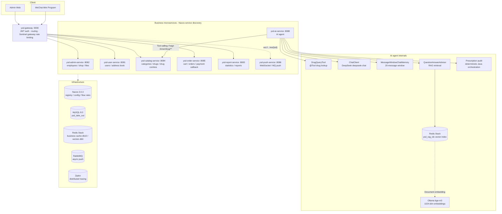

# YSD Medical Delivery (ysd-take-out) - Spring Cloud + Spring AI

*[简体中文](./README.md) | English*


---

## Overview

YSD Medical Delivery (ysd-take-out) is a **microservices-based platform for instant medical retail**: a pharmacy
operator curates the drug catalog in the admin console, customers browse and order from a WeChat Mini Program, and
the platform pushes each order to the store for acceptance and delivery. The system models the end-to-end
"browse → cart → checkout → payment → acceptance → delivery → completion" flow, with prescription compliance
checks at the critical steps.

The backend is split into a gateway plus seven domain services. **Spring Cloud** provides the operational
backbone (Nacos discovery, Gateway routing, OpenFeign, Sentinel, ShedLock, Zipkin), while **Spring AI** powers
drug lookup, medication consultation, rule retrieval and prescription compliance review through tool calling,
RAG and conversation memory.

> **Scope and status.** All performance and test figures in this repository come from a local single-node,
> single-instance environment, not from a production cluster or a production measurement. Payment is a demo
> implementation (the real WeChat Pay call is commented out), the WeChat Mini Program is excluded from this
> release pending redistribution authorization, and a few order-state transitions are not guarded yet (tracked by
> intentionally failing `bug-evidence` tests). A complete boundary list follows below.

The in-depth documentation — architecture decisions, source walkthroughs, troubleshooting playbooks and raw test
evidence — is currently written in Chinese and lives under [docs/](./docs/README.md).

---

## Key Features

### 1. Medical Business Modeling & Compliance

**Scenario.** A medical retail catalog has to support shopping and checkout while carrying regulated fields
(prescription status, approval number, indications, contraindications) that are also reused by AI consultation
and compliance review.

**Design.** The domain is modeled as "category → drug → specification → drug combo", and the database, Java
entities, REST/Feign contracts and Redis cache share the same drug vocabulary:

| Domain object | Table / entity | Key fields | Used for |
|---|---|---|---|
| Drug category | `category` | name, type, sort order, status | Admin maintenance, category browsing |
| Drug | `drug` / `Drug` | name, price, image, description, on/off-shelf status | Catalog display, snapshot on add-to-cart |
| Drug specification | `drug_spec` / `DrugSpec` | spec name, list of spec values | Package / dosage selection |
| Drug combo | `drug_combo` + `drug_combo_item` | combo name, combo price, included drugs and quantities | Bundled sales, combo pricing |

Beyond generic product attributes, the drug entity carries the structured fields a pharmacy scenario requires:
`prescription_type` (0 = OTC, 1 = prescription-only), `manufacturer`, `approval_number`, `indications` and
`contraindications`. The same fields are exposed by `Drug`, `DrugDTO`/`DrugVO`, the cross-service
`DrugInfoDTO` and the internal `/inner/drug/**` endpoints, so browsing, checkout and AI all read one source of
truth. Cache keys follow the same drug-centric naming:
`ysd:catalog:drug:{categoryId}`, `ysd:catalog:combo:{categoryId}` and `ysd:catalog:category:{type}`.

**Prescription compliance.** `prescription_type` is the shared decision input for two distinct paths:

- **Checkout path (synchronous, deterministic).** Before writing an order, `order-service` calls the internal
  `POST /inner/ai/check-prescription` endpoint. `PrescriptionAuditService` loads the prescription attribute by
  drug ID: a cart without prescription-only drugs passes; otherwise a prescription credential is mandatory.
  Lookup failures, timeouts and circuit-breaker trips all reject the order (**fail-closed**) — there is no
  "let it through and review later".
- **Consultation path (RAG + generation).** `GET /ai/prescription/check` looks up drug facts first. OTC drugs
  return a can-purchase notice; prescription-only drugs trigger a retrieval of the platform's prescription
  purchase rules and an audit notice is generated from those rules. When retrieval is empty the endpoint returns
  an error **without calling the model** — generation without evidence is fabrication.

**Verification.** The fields, endpoints and both paths are implemented in source; the rejection, timeout and
outage branches of the checkout path are covered by `OrderPrescriptionAuditTest` and the
[T31 AI failure-path record](docs/05-测试与压测/T31-AI失败路径测试记录.md).

### 2. AI Agent: Tool Calling + RAG + ChatMemory

`ysd-ai-service` is built on **Spring AI 1.1.8** and combines drug facts, platform rules and model generation:

- **Tool calling.** `DrugQueryTool` exposes drug lookup through `@Tool`; the model decides when to call it, and
  the call goes over Feign to `catalog-service` `/inner/drug/search`. Indications, contraindications and
  prescription status always come from the tool result, not from the model's memory.
- **RAG.** Eight medical knowledge documents (prescription purchase rules, OTC vs. prescription classification,
  contraindications and drug interactions, special populations, storage and cold chain) are split by
  `TokenTextSplitter`, embedded locally with **Ollama bge-m3**, and stored in a **Redis Stack** vector index
  (`ysd_rag_idx`). `QuestionAnswerAdvisor` retrieves with `topK=4` and a `0.5` similarity threshold.
- **ChatMemory.** `MessageWindowChatMemory` keeps the latest 20 messages; the memory key is scoped by
  "user + conversationId", so two users reusing the same conversation ID never see each other's history.
- **Deterministic orchestration.** The prescription audit endpoint does not let the model plan its own steps:
  Java code executes "look up drug → read prescription attribute → retrieve rules → generate audit notice" in a
  fixed order.
- **Guardrails.** The system prompt forbids inventing facts that are absent from tools and documents;
  prescription-only drugs must trigger a prescription-upload notice; endpoints are rate-limited with Sentinel
  to cap token spend; empty and over-long inputs are rejected before the model is invoked.

**Verification.** T31 covers empty input, tool failure, empty RAG retrieval, cross-user memory isolation and
fail-closed prescription review; a separate local, single-instance 20-question offline evaluation covers RAG
quality: Hit Rate@4 was 15/15 (100%) on the 15 answerable questions, and raising the similarity threshold to 0.8
dropped it to 13/15 ([retrieval design & evaluation](docs/02-架构设计与开发/AI-RAG检索设计与评测.md)).

### 3. Microservices Governance

- **Nacos** — service discovery, configuration center, and persistence of Sentinel gateway flow rules.
- **Gateway** — a single entry point with seven business routes. It validates the JWT, unconditionally strips
  any client-supplied `X-Identity-Id`, and only then injects the trusted identity header; a server-side
  interceptor adds a second line of defense for callers that bypass the gateway.
- **OpenFeign** — read-only cross-service calls with `fallbackFactory` degradation. Internal `/inner/**`
  endpoints are never exposed through the gateway, and the AI service uses dedicated 1-second connect /
  2-second read timeouts for catalog so it fails fast.
- **Sentinel** — gateway `gw-flow` rate limiting plus method-level `@SentinelResource` rules on AI endpoints.
- **Zipkin + Micrometer Tracing** — a uniform `traceId`/`spanId` log pattern across gateway and services.
- **ShedLock** — Redis-backed distributed locks around the two scheduled jobs (timeout cancellation and
  delivery completion) so multiple instances never double-run them.
- **RabbitMQ + WebSocket** — new-order and reminder messages are broadcast through a fanout exchange and
  consumed independently by every push-service instance.

### 4. High-Concurrency Cache & Distributed Consistency

- **Penetration / breakdown / avalanche.** Misses are cached as empty values, hot-key rebuilds are serialized
  through a per-key local mutex, and TTLs carry random jitter. Writes evict after commit with a delayed double
  delete, so a concurrent read cannot re-populate stale data.
- **Non-blocking invalidation.** Wildcard invalidation walks the keyspace with `SCAN` instead of `KEYS`, so a
  busy Redis instance is never blocked.
- **Cache isolation.** Business cache lives in Redis db10 under `ysd:catalog:*`; RAG vectors live in db0 under
  `ysd:rag:*`, which keeps business reads away from vector traffic.
- **Evidence.** JMeter plans cover cache hit ratio, penetration, avalanche and the delayed double-delete
  scenario (T10 / T11 / T13), with reproducible command lines and expected observations.

### 5. Database Optimization & Concurrency Safety

- **100,000 drug rows** are kept as a local long-running load-test baseline for pagination, cache and index
  verification.
- **Concurrent add-to-cart (local single-instance load test).** A 50-thread JMeter run produced 50 duplicate cart
  rows; the unique index `shopping_cart.uk_user_drug (user_id, drug_id)` now makes the database the last line of
  defense, and the same load yields `COUNT(*) = 1` (T22: reproduce → fix → regression).
- **Lock and deadlock drills.** T08 / T09 reproduce lock waits with two MySQL sessions, locate the wait chain
  through `SHOW ENGINE INNODB STATUS`, and keep the diagnostic SQL as a reusable playbook.
- **Index optimization.** A composite `(category_id, status, create_time)` index removed an `index_merge` plus
  filesort plan (measured locally on a single instance: 89 ms → 34 ms), and the low-cardinality `idx_drug_status`
  was set `INVISIBLE` so fuzzy searches fall back to a full scan instead of a large number of random lookups.
- **Connection-pool observability.** Druid active connections, waiting threads and slow SQL are captured under
  load (T06).

The SQL and conclusions are archived in
[003_database_optimization_and_fixes.sql](docs/04-运维与故障排查/003_database_optimization_and_fixes.sql) and the
[database portfolio](docs/portfolio/01-database/).

> Beyond the five areas above, the repository ships a reusable multi-stage `Dockerfile`, a Compose stack for the
> infrastructure plus the catalog and AI services, and a portfolio of reproducible engineering evidence
> (JMeter plans, IDOR regression, AI failure-path matrix, RAG evaluation) indexed in
> [docs/portfolio/README.md](docs/portfolio/README.md).

---

## System Architecture



**Architecture notes**

- All clients enter through the gateway on `:9000`, which routes by business path prefix.
- `ysd-ai-service` sits behind the gateway `/ai/**` route and requires the customer `authentication` header.
  The service itself only trusts the `X-Identity-Id` header injected by the gateway and rejects direct calls.
- Services are split by business domain but still share one MySQL database (`ysd_take_out`) and Redis db10.
  The database has not been split vertically yet — a deliberate transitional trade-off that keeps migration
  and comparison straightforward.
- Vector data is written to Redis Stack **db0** under the `ysd:rag:` prefix, isolated from business cache.

---

## Technology Stack

| Category | Technology | Version |
|---|---|---|
| Language / runtime | Java | 21 |
| Base framework | Spring Boot | 3.5.16 |
| Microservices | Spring Cloud | 2025.0.0 |
| Microservices (Alibaba) | Spring Cloud Alibaba | 2025.0.0.0 |
| AI framework | Spring AI | 1.1.8 |
| LLM | DeepSeek `deepseek-chat` (OpenAI-compatible API) | — |
| Embeddings | Ollama `bge-m3` (1024 dimensions) | — |
| Vector store | Redis Stack / RediSearch | latest |
| Registry / config | Nacos | 3.0.3 |
| Gateway | Spring Cloud Gateway (WebFlux) | Spring Cloud 2025.0.x |
| Flow control | Sentinel | Spring Cloud Alibaba 2025.0.x |
| Tracing | Micrometer Tracing + Brave + Zipkin | Spring Boot BOM |
| Persistence | MyBatis Spring Boot Starter / PageHelper | 3.0.5 / 2.1.1 |
| Connection pool | Druid (`druid-spring-boot-3-starter`) | 1.2.28 |
| Database | MySQL | 8.x |
| Cache | Redis / Spring Data Redis (Lettuce) | — |
| Messaging | RabbitMQ | — |
| Distributed job locks | ShedLock | 6.9.0 |
| Authentication | JJWT | 0.12.6 |
| API docs | knife4j / springdoc-openapi | 4.5.0 / 2.8.17 |
| Excel export | Apache POI | 5.5.1 |
| Object storage | Alibaba Cloud OSS SDK | 3.18.5 |
| Payments | wechatpay-apache-httpclient | 0.6.0 |

## Project Structure

```text
ysd-take-out/
├── ysd-common/              # Result wrapper, exceptions, JWT, ThreadLocal context
├── ysd-pojo/                # entities, DTOs, VOs
├── ysd-api/                 # cross-service contracts: Feign clients + DTOs
├── ysd-gateway/             # gateway :9000 (routing + JWT + Sentinel)
├── ysd-user-service/        # users / address book :8081
├── ysd-admin-service/       # employees / shop / files :8082
├── ysd-report-service/      # statistics / Excel export :8083
├── ysd-catalog-service/     # categories / drugs / drug combos :8084
├── ysd-order-service/       # cart / orders / payment callback / scheduled tasks :8085
├── ysd-push-service/        # WebSocket / RabbitMQ :8086
├── ysd-ai-service/          # AI agent / RAG / ChatMemory :8088
├── ysd-admin-web/           # admin frontend (Vue 2 + TypeScript + Element UI)
├── ysd-miniapp/             # customer mini program (not included in this release)
├── docker/mysql/init/       # schema loaded on first MySQL startup
├── docker/nginx/            # sample Nginx reverse proxy for the admin console
├── scripts/                 # open-source export and start/stop scripts
├── docker-compose.yml       # infrastructure + catalog + AI
├── Dockerfile               # multi-stage build, reusable via MODULE
├── SECURITY.md              # security policy and hardening checklist
├── CONTRIBUTING.md          # contribution guide
└── docs/                    # architecture, source tours, operations, testing (Chinese)
```

**Ports**

| Component | Port | Purpose |
|---|---|---|
| ysd-gateway | 9000 | Single business entry point |
| ysd-user-service | 8081 | Users / address book |
| ysd-admin-service | 8082 | Employees / shop / files |
| ysd-report-service | 8083 | Statistics / reports |
| ysd-catalog-service | 8084 | Categories / drugs / drug combos |
| ysd-order-service | 8085 | Cart / orders / payment callback |
| ysd-push-service | 8086 | WebSocket / MQ |
| ysd-ai-service | 8088 | AI agent (via gateway `/ai/**`; direct access returns 401) |
| Nacos | 8848 / 9848 | Client API / gRPC |
| Nacos console | 8849 | Compose mapping, avoids host port 8080 |
| MySQL | 3307 | Compose mapping, avoids host port 3306 |
| Redis Stack | 6379 | Business cache db10 / vectors db0 |
| Zipkin | 9411 | Not bundled in Compose; start on demand |

---

## Quick Start

### Prerequisites

| Dependency | Requirement |
|---|---|
| Docker | Docker Desktop / Docker Engine |
| Docker Compose | v2 (`docker compose`) |
| Memory | 8 GB or more recommended (Nacos + MySQL + Redis + two Java services) |
| JDK / Maven | JDK 21 and Maven 3.9 — only needed to run the remaining services on the host |
| Ollama | AI service only; host listener on `0.0.0.0:18434` with `bge-m3` pulled |
| DeepSeek API key | AI chat only; the rest of the stack starts without it |

### 1. Configure `.env`

```bash
cp .env.example .env
```

On Windows you can copy the file directly:

```powershell
Copy-Item .env.example .env
```

Edit `.env`. **The following variables are required for Compose:**

```dotenv
# MySQL
MYSQL_ROOT_PASSWORD=your-strong-root-password
MYSQL_USERNAME=root
MYSQL_PASSWORD=your-strong-root-password

# Nacos 3.x authentication
# Generate the token with `openssl rand -base64 32`, then paste the output
NACOS_AUTH_TOKEN=paste-base64-random-32-bytes-here
NACOS_ADMIN_PASSWORD=your-nacos-password
NACOS_USERNAME=nacos
NACOS_PASSWORD=your-nacos-password

# AI (optional; without it AI chat fails but services still start)
DEEPSEEK_API_KEY=sk-xxxxxxxxxxxxxxxx
```

Notes:

- `NACOS_AUTH_TOKEN` must be Base64 and decode to at least 32 bytes. `.env` does not execute shell commands,
  so run `openssl rand -base64 32` first and paste the result.
- Keep `NACOS_ADMIN_PASSWORD` and `NACOS_PASSWORD` identical: the former initializes the `nacos` administrator,
  the latter is used by services to register and fetch configuration.
- `.env` is excluded by `.gitignore`; **never commit real secrets**.
- For registry mirrors, uncomment and set `MAVEN_IMAGE` / `JRE_IMAGE` / `REDIS_IMAGE` in `.env`.

### 2. Prepare Ollama (required by the AI service)

Containers need to reach Ollama running on the host:

```bash
# 1) Let Ollama listen on all interfaces (restart Ollama after setting this on Windows)
#    Windows:
setx OLLAMA_HOST 0.0.0.0:18434
#    Linux:
OLLAMA_HOST=0.0.0.0:18434 ollama serve

# 2) Pull the embedding model
ollama pull bge-m3
```

> Compose injects `OLLAMA_BASE_URL=http://host.docker.internal:18434`.
> To run without AI, start only the infrastructure and catalog:
> `docker compose up -d nacos nacos-init mysql redis ysd-catalog-service`.

### 3. Launch the stack

```bash
docker compose up -d
```

The first run builds the `ysd-catalog-service` and `ysd-ai-service` images; duration depends on network and
dependency cache. Check status and logs:

```bash
docker compose ps
docker compose logs -f ysd-catalog-service
docker compose logs -f ysd-ai-service
```

Startup order is controlled by `depends_on` and health checks:

```text
Nacos → nacos-init → MySQL / Redis → catalog-service → ai-service
```

### 4. Verify

| Entry | Address |
|---|---|
| Nacos console | http://localhost:8849 (user `nacos`, password `NACOS_ADMIN_PASSWORD`) |
| catalog health | http://localhost:8084/actuator/health |
| catalog API docs | http://localhost:8084/doc.html |
| AI health | http://localhost:8088/actuator/health |
| MySQL | `127.0.0.1:3307`, database `ysd_take_out` |
| Redis Stack | `127.0.0.1:6379` |

MySQL runs `docker/mysql/init/01-schema.sql` the first time the data volume is created. To wipe and re-initialize:

```bash
docker compose down -v
docker compose up -d
```

### 5. Run the remaining services locally (Maven)

Compose does not include gateway / user / admin / report / order / push. Start them on the host:

```bash
# Build all modules once
mvn clean install -DskipTests

# Start the services you need (Nacos is provided by Compose on 127.0.0.1:8848)
mvn -pl ysd-user-service    spring-boot:run
mvn -pl ysd-admin-service   spring-boot:run
mvn -pl ysd-report-service  spring-boot:run
mvn -pl ysd-order-service   spring-boot:run
mvn -pl ysd-push-service    spring-boot:run

# Finally start the gateway on :9000
mvn -pl ysd-gateway spring-boot:run
```

Alternatively, use `start-all.sh` on a machine that already has JDK 21, Maven and the middleware running:

```bash
./start-all.sh --build   # build every module, then start
./start-all.sh           # reuse existing jars, skip services already listening
./start-all.sh --no-ai   # skip the AI service
./stop-all.sh            # stop all services (add --infra to stop local Docker middleware)
```

The script checks MySQL / Redis / Nacos / RabbitMQ ports (attempting `docker start` for same-named containers),
starts user / catalog / order / report / admin / push / ai / gateway in order, waits for ports, and writes logs
to `logs/*.out.log` and PIDs to `logs/*.pid`.

You can extend Compose with the generic Dockerfile:

```bash
docker build --build-arg MODULE=ysd-order-service -t ysd/ysd-order-service:1.0.0 .
```

> When adding a container to Compose, set `SPRING_CLOUD_NACOS_DISCOVERY_IP` to the service name
> (for example `ysd-order-service`); otherwise the `127.0.0.1` from `application.yml` is registered in Nacos and
> other services cannot reach it by name. Host-local runs can keep `127.0.0.1`.

### 6. Start the admin frontend

Requires Node.js and npm. Make sure the gateway is already listening on `:9000`:

```bash
cd ysd-admin-web
npm install
npm run serve
```

The dev server defaults to `http://localhost:8888` (see `devServer.port` in `ysd-admin-web/vue.config.js`) and
proxies `/api` to `VUE_APP_URL` from `.env.development` (default `http://localhost:9000/admin`); WebSocket
traffic goes to `ws://localhost:9000/ws/`.

> The admin console uses Vue CLI 3 / Webpack 4; Node 16 LTS is recommended. Node 24 is known to fail in
> workbox-build while generating the service worker (`assignWith is not defined`), and `npm ci` may complain
> about a lock/package.json mismatch — `npm install` works around it.

### 7. Try the AI endpoints (optional)

AI requests go through the gateway, so they need a customer JWT in the `authentication` header. Direct access to
`:8088` returns 401.

```bash
TOKEN=$(python jmeter/gen-user-token.py 4)

# Blocking chat (Tool Calling + RAG + ChatMemory)
curl -X POST "http://localhost:9000/ai/drug/chat" \
  -H "authentication: $TOKEN" \
  -H "Content-Type: application/json; charset=UTF-8" \
  --data-binary '{"message":"布洛芬的禁忌是什么？"}'

# Prescription compliance review
curl -G "http://localhost:9000/ai/prescription/check" \
  -H "authentication: $TOKEN" \
  --data-urlencode "drugName=阿莫西林"
```

> The demo catalog stores Chinese drug names, so the examples above query in Chinese; use the same language as the
> data for tool lookup and prescription review to match records.

Reuse the `conversationId` returned by the first call to continue the same conversation, or call
`POST /ai/drug/chat/stream` with `Accept: text/event-stream` for SSE streaming (`message` events carry text,
`done` carries the `conversationId`, `error` carries a failure message).

### 8. Stop

```bash
docker compose down       # stop containers, keep volumes
docker compose down -v    # stop and delete MySQL / Redis / Nacos data
```

---

## Current Status & Boundaries

To keep design goals separate from shipped code, the current boundaries are:

- All services are split by domain: a gateway plus seven business services
  (user / admin / report / catalog / order / push / ai); no monolith runtime module remains in the repository.
- The architecture is still transitional: one shared MySQL database (`ysd_take_out`) and one shared Redis db10;
  the database has not been split vertically.
- A few early order-table columns keep the legacy `tableware_*` names. The recent cleanup was documentation-only
  and did not change schemas, entities or APIs.
- `docker-compose.yml` currently covers **Nacos / MySQL / Redis Stack / catalog / AI**; gateway / user / admin /
  report / order / push must run on the host or be added to Compose manually.
- Compose does not bundle Zipkin or RabbitMQ. Tracing is disabled by default inside the containers
  (`MANAGEMENT_TRACING_ENABLED=false`); start Zipkin on the host and re-enable it if needed.
- AI chat needs a DeepSeek API key; RAG needs Ollama and the `bge-m3` model on the host.
- Payment is a **demo implementation**: `OrderServiceImpl.payment()` does not call WeChat Pay; it constructs
  `ORDERPAID` and updates the order directly (the real `weChatPayUtil.pay(...)` call is commented out). WeChat
  login and Alibaba Cloud OSS require real credentials before integration testing.
- The order state machine does not yet guard all transitions: `confirm` / `cancel` can move an order back from
  "completed", and `payment` does not validate order state. These are kept as intentionally failing
  `@Tag("bug-evidence")` cases in `OrderStateMachineTest`.
- The customer Mini Program is **not part of this release** (redistribution authorization pending). Even with the
  directory, the backend does not implement cart quantity update/delete, shop phone, or filtering orders by
  payment status.
- Business services bind `127.0.0.1` by default and use `SERVER_ADDRESS=0.0.0.0` in containers. Only the gateway
  should be exposed; **do not publish 8081–8088 to the internet**. The gateway unconditionally strips any
  client-supplied `X-Identity-Id` before validating the JWT and injecting the trusted identity header.

---

## Security

- **No sensitive data is shipped**: the repository and its Git history contain no real keys, certificates or
  production credentials; all sensitive configuration is injected through environment variables, and
  `.env.example` contains placeholders only.
- `.env` and `.env.*` are excluded by `.gitignore` (only `.env.example` is tracked); logs, certificates,
  load-test artifacts and frontend build output are excluded as well.
- This audit scanned the working tree and Git history for common secret patterns; no real credentials were found.
  Report any suspected leak privately via [SECURITY.md](./SECURITY.md), not in a public issue.
- JWTs in the test evidence are short-lived local development tokens (already expired) signed with local default
  secrets; the test data contains no real user phone numbers, addresses or production credentials.
- Business services bind `127.0.0.1` by default and only the gateway should be public. Production deployments must
  replace demo secrets and default passwords and restrict public access to Swagger / Actuator.

---

## License & Attribution

Released under the [MIT License](./LICENSE).

```text
Copyright (c) 2026 Yaosuda (ysd-take-out) Contributors
```

Third-party components and assets are documented in [NOTICE.md](./NOTICE.md). In particular, the admin frontend
is derived from [vue-typescript-admin](https://github.com/Armour/vue-typescript-admin-template)
(MIT, Copyright (c) 2018 Chong Guo), and the customer Mini Program is not part of this release pending
redistribution authorization.

Built on the Spring ecosystem (Spring Boot, Spring Cloud, Spring Cloud Alibaba, Spring AI). Thanks to
[Nacos](https://nacos.io/), [Sentinel](https://sentinelguard.io/), [Zipkin](https://zipkin.io/),
[Redis](https://redis.io/), [RabbitMQ](https://www.rabbitmq.com/), [DeepSeek](https://www.deepseek.com/),
and [Ollama](https://ollama.com/) with `bge-m3`.

Contributions are welcome — see [CONTRIBUTING.md](./CONTRIBUTING.md). Please report security issues privately as
described in [SECURITY.md](./SECURITY.md).
