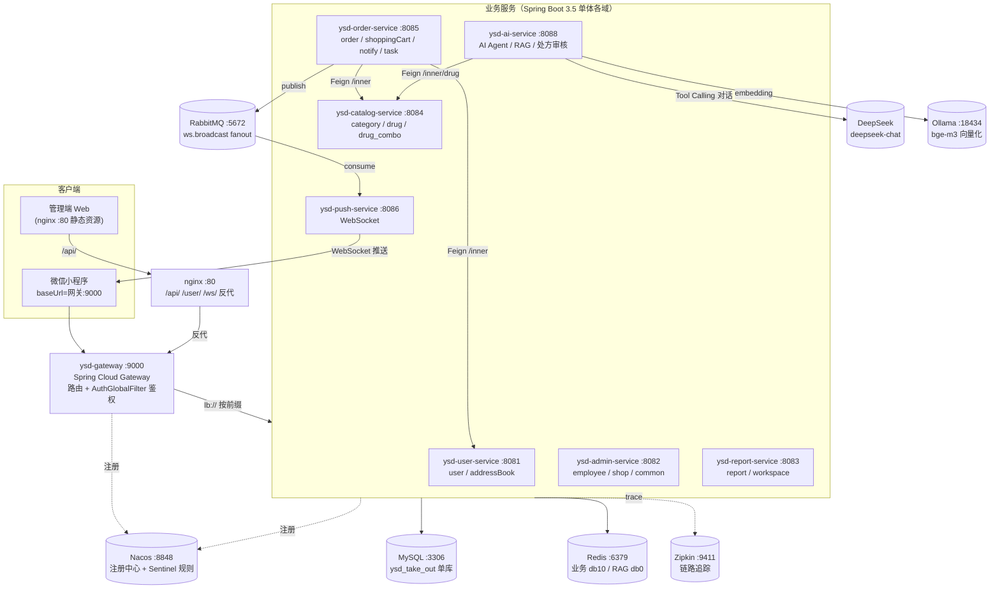
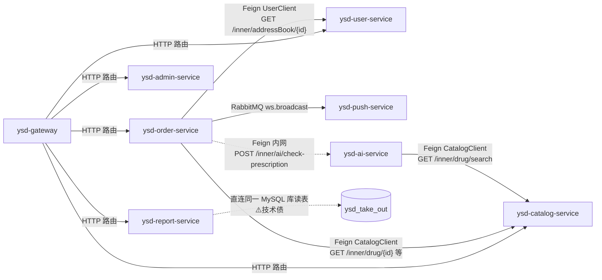
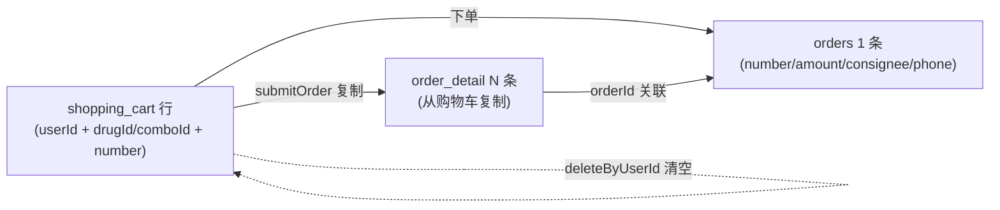

# 01 · 项目全景图（ysd-take-out 药速达智慧配送平台）

> 本文所有结论均来自当前仓库源码，路径与类名已逐条核对。
> 涉及「配置存在但未运行验证」「需运行确认」的地方，均用 **⚠️未验证** 明确标注，不臆断。
> 校对基线：分支 `master`，扫描日期 2026-10-21（含 `ysd-ai-service` AI 模块与药品字段迁移后的状态）。

---

## 一、这个项目解决什么业务问题

**药速达**是一个**同城即时配送系统**，对标「外卖 / 跑腿」平台的经典形态：商家在后台维护商品（分类、药品、药品组合），用户在微信小程序下单，系统把订单推给商家，商家接单后派送。

它包含两端：

- **管理端 Web（商家用）**：员工登录、商品维护、订单处理、经营看板、报表导出。
- **用户端 微信小程序（顾客用）**：微信登录、浏览商品、加购物车、下单、支付、查历史订单、催单。

> 📌 项目原名来自某培训教程（苍穹外卖）。本仓库已完成**品牌改名（药速达）+ 架构升级（JDK8→JDK21、Spring Boot 3.5）+ 微服务拆分**，因此代码里会有教程遗留痕迹与改造痕迹并存的现象（例如大量中文注释、部分注释掉的微信支付代码）。

## 二、主要用户与业务场景

| 角色 | 入口 | 典型场景 |
|---|---|---|
| 商家员工（admin） | 管理端 Web | 登录后台 → 新增药品 → 设置在售 → 查看/接单 → 导出报表 |
| 顾客（user） | 微信小程序 | 微信授权登录 → 浏览分类药品 → 加购物车 → 下单 → 支付 → 催单/再来一单 |
| 平台（系统自身） | 定时任务 / MQ | 超时未支付订单自动取消、待派送订单自动完成、来单/催单 WebSocket 推送 |

## 三、实际实现的核心功能（源码为准）

**管理端**（各自实际源码）：
- 员工管理：登录 / 退出 / 新增 / 分页 / 启停 / 查询 / 编辑 — `ysd-admin-service` `controller/admin/EmployeeController.java`
- 店铺营业状态：设置 / 查询 — `ysd-admin-service` `controller/admin/ShopController.java`
- 文件上传（阿里云 OSS）— `ysd-admin-service` `controller/admin/CommonController.java`
- 分类 / 药品 / 药品组合维护 — `ysd-catalog-service` `controller/admin/{Category,Drug,DrugCombo}Controller.java`
- 订单管理（搜索/统计/详情/接单/拒单/取消/派送/完成）— `ysd-order-service` `controller/admin/OrderController.java`
- 报表统计（营业额/用户/订单/销量 Top10/Excel 导出）— `ysd-report-service` `controller/admin/ReportController.java`
- 工作台看板（营业数据/订单/药品/药品组合概览）— `ysd-report-service` `controller/admin/WorkSpaceController.java`

**用户端**：
- 微信登录 — `ysd-user-service` `controller/user/UserController.java`
- 地址簿增删改查 — `ysd-user-service` `controller/user/AddressBookController.java`
- 浏览分类/药品/药品组合、店铺状态 — `ysd-catalog-service` `controller/user/*Controller.java`
- 购物车加/查/清 — `ysd-order-service` `controller/user/ShoppingCartController.java`
- 订单下单/支付/历史/详情/取消/再来一单/催单 — `ysd-order-service` `controller/user/OrderController.java`
- 微信支付回调 — `ysd-order-service` `controller/notify/PayNotifyController.java`

**平台能力**：
- 双端 JWT 鉴权（网关统一校验 + 服务端拦截器兜底）
- Redis 缓存 + 防击穿/穿透/雪崩 + 延迟双删（catalog）
- 跨服务 Feign 只读调用 + Sentinel 熔断降级
- RabbitMQ 广播 → 独立 WebSocket 推送服务
- ShedLock 分布式锁保护的定时任务
- Zipkin 链路追踪、knife4j 接口文档、全局异常处理、公共字段自动填充

**AI 能力**（`ysd-ai-service`，经网关 `/ai/**`）：
- 药品问答：`POST /ai/drug/chat`（阻塞）与 `/ai/drug/chat/stream`（SSE 流式）
- Tool Calling：`@Tool` 药品查询（经 Feign 调 catalog `/inner/drug/**`）
- RAG 检索增强：8 份医药业务知识文档 → Redis Stack/RediSearch（索引 `ysd_rag_idx`）→ `QuestionAnswerAdvisor(topK=4, thr=0.5)`；空召回直接拒答
- 多轮会话记忆：`MessageWindowChatMemory(20)` + 按用户/会话隔离
- 处方药审核：`/ai/prescription/check` 与内网 `/inner/ai/check-prescription`，下单时 fail-closed
- 方法级 Sentinel 限流（`aiQuery`/`aiStream`/`aiPrescriptionCheck`）

## 四、技术栈及各自作用（附源码依据）

| 分类 | 技术 | 版本 | 在本项目中的作用 | 依据 |
|---|---|---|---|---|
| 语言 | Java | 21 | 目标字节码版本 | `pom.xml:29` |
| 基础框架 | Spring Boot | 3.5.16 | 各服务独立启动 | `pom.xml:9` |
| 微服务 | Spring Cloud | 2025.0.0 | 网关/负载均衡/OpenFeign | `pom.xml:166` |
| 微服务 | Spring Cloud Alibaba | 2025.0.0.0 | Nacos 注册、Sentinel 限流熔断 | `pom.xml:174` |
| 注册中心 | Nacos | 3.0.3 | 服务发现（`lb://` 靠它解析） | 各 `application.yml` `cloud.nacos.discovery` |
| 网关 | Spring Cloud Gateway(WebFlux) | SC 2025.0.x | 统一入口 9000、路由、JWT 鉴权 | `ysd-gateway/application.yaml:31` |
| 持久层 | MyBatis Starter / PageHelper | 3.0.5 / 2.1.1 | 手写 SQL + 分页 | `pom.xml:71,96` |
| 连接池 | Druid | 1.2.28 | 数据源 | `pom.xml:89` |
| 数据库 | MySQL | 8.x | 单库 `ysd_take_out` | 各 `application.yml` datasource |
| 缓存 | Redis(Lettuce) | — | 商品缓存、店铺状态、ShedLock、Sentinel | `catalog/application.yml:23` |
| 鉴权 | jjwt | 0.12.6 | JWT 签发/解析 | `common/utils/JwtUtil.java` |
| 服务调用 | OpenFeign | SC 2025.0.x | order→user/catalog 只读调用 | `ysd-api/api/client/*` |
| 限流熔断 | Sentinel | SCA 2025.0.0.0 | 网关流控 + Feign 熔断 | `gateway/application.yaml:16` |
| 消息 | RabbitMQ | — | WebSocket 跨实例广播 | `push-service/config/RabbitConfig.java` |
| 链路追踪 | Micrometer + Zipkin | — | traceId 贯穿服务 | 各 `application.yml` `management.tracing` |
| 定时锁 | ShedLock | 6.9.0 | 多实例定时任务防重 | `order/config/ShedLockConfiguration.java` |
| 接口文档 | knife4j / springdoc | 4.5.0 / 2.8.17 | `/doc.html` | `pom.xml:105,111` |
| Excel | Apache POI | 5.5.1 | 报表导出 | `pom.xml:153` |
| 对象存储 | 阿里云 OSS SDK | 3.18.5 | 文件上传 | `common/utils/AliOssUtil.java` |
| 支付 | wechatpay-apache-httpclient | 0.6.0 | 微信支付/退款工具 | `common/utils/WeChatPayUtil.java` |
| AI 框架 | Spring AI | 1.1.8 | ChatClient / Tool Calling / RAG Advisor / 会话记忆 | `pom.xml:182-190`（spring-ai-bom） |
| 大模型 | DeepSeek（OpenAI 兼容协议） | deepseek-chat | AI 对话主模型 | `ysd-ai-service/application.yml` `spring.ai.openai` |
| 向量化 | Ollama `bge-m3` | 1024 维 | 本地 embedding（项目约定端口 18434） | `ysd-ai-service/application.yml` `spring.ai.ollama` |
| 向量库 | Redis Stack / RediSearch | latest | RAG 向量索引 `ysd_rag_idx`（db0） | `ai/config/RagConfig.java` |

## 五、目录结构与模块职责

父工程 `pom.xml:15-27` 声明 11 个 module：

```
ysd-take-out/
├── pom.xml                # 父工程：BOM 版本管理 + 11 module
├── ysd-common/            # jar 通用层
│   ├── annotation/AutoFill.java          # 公共字段填充注解
│   ├── aspect/AutoFillAspect.java        # 填充切面（AOP）
│   ├── context/BaseContext.java          # ThreadLocal 存当前登录 id
│   ├── interceptor/InnerIdentityInterceptor.java  # /inner/** 身份透传
│   ├── exception/*.java                  # 业务异常体系（BaseException 及子类）
│   ├── result/{Result,PageResult}.java   # 统一返回
│   ├── json/JacksonObjectMapper.java     # 统一日期格式
│   ├── properties/*.java                 # JwtProperties/WeChatProperties/AliOssProperties
│   └── utils/{JwtUtil,AliOssUtil,HttpClientUtil,WeChatPayUtil}.java
├── ysd-pojo/              # jar 领域模型：entity(11)/dto(21)/vo(17)
├── ysd-api/               # jar 服务间契约（不是可启动服务）
│   ├── client/CatalogClient.java         # Feign：查药品/药品组合快照
│   ├── client/UserClient.java            # Feign：查地址簿快照
│   ├── client/fallback/*FallbackFactory  # 熔断降级
│   ├── dto/*SnapshotDTO.java             # 跨服务传输的"快照"
│   └── interceptor/FeignRequestInterceptor(+Configuration)
├── ysd-gateway/           # 可启动 :9000  路由 + AuthGlobalFilter 鉴权
├── ysd-user-service/      # 可启动 :8081  用户登录 + 地址簿（+ /inner 地址快照）
├── ysd-admin-service/     # 可启动 :8082  员工 + 店铺 + 文件上传
├── ysd-report-service/    # 可启动 :8083  报表 + 工作台（直读业务库，技术债）
├── ysd-catalog-service/   # 可启动 :8084  分类/药品/药品组合 + 缓存（+ /inner 商品快照）
├── ysd-order-service/     # 可启动 :8085  订单/购物车/支付回调/定时任务/MQ生产
├── ysd-push-service/      # 可启动 :8086  仅 WebSocket + MQ消费（无数据库）
└── ysd-ai-service/        # 可启动 :8088  AI Agent（Spring AI + DeepSeek + RAG + 处方审核）
```

> 综上：父工程共 **11 个 module**，其中 **8 个可启动服务**（网关 + 7 个业务服务：user/admin/report/catalog/order/push/**ai**）。

> **重要**：`ysd-api` **不是业务服务**，它是被 order-service 依赖的「接口 jar」，只放 Feign 接口、快照 DTO 和出站拦截器。真正的卖家（服务端实现）在 catalog/user 的 `controller/inner/` 里。

## 六、前后端架构与模块依赖

### 6.1 请求入口与路由（`ysd-gateway/src/main/resources/application.yaml:31-70`）

网关按**路径前缀**把请求路由到不同服务（`lb://` = 从 Nacos 取实例 + 负载均衡）：

| 路由 id | 断言 Path | 目标 |
|---|---|---|
| ysd-admin-service | `/admin/employee/**`,`/admin/shop/**`,`/admin/common/**` | :8082 |
| ysd-user-service | `/user/user/**`,`/user/addressBook/**` | :8081 |
| ysd-report-service | `/admin/report/**`,`/admin/workspace/**` | :8083 |
| ysd-catalog-service | `/admin/{category,drug,drug-combo}/**`,`/user/{category,drug,drug-combo,shop}/**` | :8084 |
| ysd-order-service | `/admin/order/**`,`/user/order/**`,`/user/shoppingCart/**`,`/notify/**` | :8085 |
| ysd-push-service-ws | `/ws/**`（`lb:ws://`） | :8086 |
| ysd-ai-service | `/ai/**` | :8088 |

> 共 **7 条路由**。`/ai/**` 必须携带用户端 `authentication` 头；网关在鉴权后注入 `X-Identity-Id`，AI 服务直连 `:8088` 会被 `IdentityGuardFilter` 拒绝（401）。

### 6.2 系统架构图（真实拓扑）



### 6.3 服务间调用关系（谁依赖谁）



要点：
- **Feign 方向基本单向**：`order-service` 通过 `ysd-api` 调 `user-service`/`catalog-service`；`ai-service` 也通过 `ysd-api` 只读调 `catalog-service`（药品查询工具与处方审核取药）。
- **新增反向例外**：`order-service` 下单前会经内网 `POST /inner/ai/check-prescription` 同步调用 `ai-service` 做处方药闸门（fail-closed）。
- **report-service 没有 Feign**：它直接读同一 MySQL 库的 `orders/user/drug/drug_combo` 等表（源码与配置注释均自认技术债，`report/application.yml:2`）。
- **push-service 没有数据库依赖**，只连 RabbitMQ + Nacos。

## 七、系统启动流程

单个服务的启动要点（以 order-service 为例，`YsdOrderServiceApplication.java:20-32`）：

1. `@SpringBootApplication` 扫描 `com.ysd` 下的 Controller/Service/Mapper。
2. `@EnableDiscoveryClient` → 向 Nacos 注册服务名（供网关 `lb://` 解析）。
3. `@EnableFeignClients(basePackages = "com.ysd.api.client")` → 生成 `UserClient`/`CatalogClient`/`AiPrescriptionClient` 代理。
4. `@EnableTransactionManagement` → 开启 `@Transactional`。
5. `@EnableScheduling` + `@EnableSchedulerLock(defaultLockAtMostFor="PT10M")` → 定时任务 + ShedLock。
6. 启动后 `main` 打印 `order service started`。

**建议启动顺序**：Nacos → MySQL/Redis(**Stack**)/RabbitMQ → 各 `ysd-*-service` → `ysd-ai-service`（需 `DEEPSEEK_API_KEY`、Redis Stack、Ollama 18434）→ `ysd-gateway`。
（网关 `lb://` 需要目标服务已在 Nacos 注册，否则路由 503。）

> ⚠️未验证：README 建议顺序如此，但未实际运行验证端口/中间件版本组合。验证方法见 `docs/04-运维与故障排查/06-故障排查手册.md`。

## 八、核心业务对象与数据流转关系

**数据库**：单库 `ysd_take_out`，11 张表（建表语句见 `docker/mysql/init/01-schema.sql`；增量迁移 001/002 见 `docker/mysql/migrations/`，003 见 `docs/04-运维与故障排查/003_database_optimization_and_fixes.sql`，均已执行）：

| 表 | 归属服务 | 说明 |
|---|---|---|
| `category` / `drug` / `drug_spec` / `drug_combo` / `drug_combo_item` | catalog | 分类、药品、规格、药品组合、药品组合-药品关联 |
| `orders` / `order_detail` / `shopping_cart` | order | 订单、订单明细、购物车 |
| `user` / `address_book` | user | 用户、地址簿 |
| `employee` | admin | 员工 |

**核心对象流转（下单）**：



- **顾客 id** 来自 `BaseContext`（ThreadLocal），由拦截器写入；下单时 `orders.userId = BaseContext.getCurrentId()`（`OrderServiceImpl.java:80,101`）。
- **收货人/电话** 来自 `address_book` 快照（跨服务 Feign 取，`OrderServiceImpl.java:74,99-100`）。
- **药品名/图/价** 来自 `drug`/`drug_combo` 快照（加购物车时 Feign 取，`ShoppingCartServiceImpl.java:55-65`）。

## 九、功能落地状态（三档区分）

### ✅ 源码已实现
双端 JWT、网关统一鉴权 + 身份透传、Feign 只读调用 + 降级工厂、catalog 缓存（防击穿/穿透/雪崩、延迟双删）、订单状态机、RabbitMQ→WebSocket 广播、ShedLock 定时防重、Zipkin 追踪埋点、全局异常、`@AutoFill` 切面、OSS 上传、Excel 导出。
AI（`ysd-ai-service`）：药品问答（阻塞 + SSE 流式）、Tool Calling、RAG 检索（8 份医药知识库 + 20 题评测）、多轮会话记忆（按用户/会话隔离）、处方审核 + 下单 fail-closed 闸门、方法级 Sentinel 限流。

### ⚠️ 配置存在 / 但实现有折损（面试必须说清）
- **微信支付是「假支付」**：`OrderServiceImpl.payment()`（`:136-168`）里真正的 `weChatPayUtil.pay(...)` 被**注释掉了**，改为直接构造 `ORDERPAID` 并调用 `orderMapper.updateStatus(...)` 把订单置为已支付。`paySuccess()` 与 `WeChatPayUtil.refund()` 仍在，但支付主流程并未真实走微信。
- **Sentinel 熔断降级「代码就绪但未验证触发」**：`@FeignClient(fallbackFactory=...)` 与 `spring.cloud.openfeign.circuitbreaker.enabled=true`（`order/application.yml:36-38`）都在，规则存 Nacos ⚠️未验证。
- **报警/催单推送**：`WsPushProducer.push()` 发 `ws.broadcast`，push-service 消费后推本实例客户端（`WsPushListener.java:24-28`）——链路代码完整，⚠️跨实例行为未运行验证。
- **AI 会话记忆只存内存**：`MessageWindowChatMemory(20)` 不持久化，多实例下不共享；RAG 召回仅在 20 题自建问题集上评估，未做 rerank。

### ❌ 未实现 / 自认技术债
- `shopping_cart` 缺「价格快照」字段（加购后改价会污染历史购物车，README「已知问题」）。
- **密钥明文**（见第十节）。
- report-service 直读业务库（跨服务 JOIN 债）。
- 多实例下支付回调幂等、定时任务除 ShedLock 外的一致性未深入处理。

## 十、🔒 安全问题单独记录（不含密钥值）

| 位置 | 字段 | 风险 | 整改建议 |
|---|---|---|---|
| `ysd-order-service/src/main/resources/application.yml:83-88` | `ysd.wechat.appid` / `ysd.wechat.secret` | 微信 appid/secret **明文入库**，泄露可冒用小程序身份 | 改环境变量占位（参考 admin 的 `${ALIYUN_OSS_ACCESS_KEY_ID:}` 写法）或 Nacos 配置中心 |
| `ysd-user-service/src/main/resources/application.yml:38-40` | `ysd.wechat.appid` / `ysd.wechat.secret` | 同上 | 同上 |
| `ysd-order-service/.../application.yml:87-88` | `notifyURL`/`refundNotifyUrl` | 内网穿透域名（cpolar）写死，非密钥但属环境信息 | 挪到环境变量 |
| 历史遗留 | `application-dev.yml`（原 ysd-server，模块已删除） | 曾明文提交 OSS Key / 微信密钥进 git | 轮换已泄露密钥 |

> 对照：`ysd-admin-service/application.yml:46-50` 的 OSS 配置**已正确**用 `${ALIYUN_OSS_ACCESS_KEY_ID:}` 占位，可作为整改模板。
> 本文档及后续文档**一律只写文件路径+字段名，不复制密钥值**。

## 十一、技术特点、明显不足与学习优先级

**技术特点**：
- 完整的微服务「过渡态」实战：网关鉴权 + Feign 熔断 + MQ 广播 + 分布式定时锁 + 链路追踪，是一份**能讲清楚"为什么这么拆"**的高质量素材。
- 改造痕迹清晰，便于对照「单体→微服务」的每一步动机。

**明显不足**（诚实认知，面试别吹）：
- 数据层未拆（共库共表），report 直读他域表。
- 缓存一致性用「延迟双删 + 本地锁」，多实例下防击穿失效（`CatalogCacheHelper.java:88-90` 自认 TODO）。
- 无真实支付、无 K8s/CI/CD（已有 Docker Compose 起中间件与服务镜像）。

**学习优先级（后文 08 会展开成任务）**：
1. 全局地图 + 请求进入体（网关→拦截器→Controller）
2. 下单事务链（跨服务 + 事务 + 快照）
3. 缓存三件套 + 延迟双删
4. MQ→WebSocket 广播与定时任务
5. 框架原理（AOP/事务/MyBatis）与故障排查

## 十二、自测题（能否不看文档回答）

1. `ysd-api` 是可启动服务吗？它的 `CatalogClient` 最终打到哪个服务的哪个 URL？
2. 网关一共几条路由？`/user/shop/status` 命中哪条、被路由到哪个服务？
3. 用户下单时「收货人电话」是从本地表查的还是跨服务取的？走什么协议？
4. `report-service` 为什么不需要 Feign？这带来什么风险？
5. 微信支付在主流程里真的调用了吗？证据在哪一行？
6. WebSocket 消息从 order-service 到小程序，中间经过哪几个组件？
7. 单库 `ysd_take_out` 里 `orders` 表由哪个服务写入？`report` 能读它吗？
8. 项目里哪些配置是「代码就绪但未运行验证」的？举 2 个。
9. 现在有几个明文密钥位置？整改模板在哪个文件？
10. 如果网关先于业务服务启动，`lb://` 路由会发生什么？
11. AI 服务直连 `:8088` 为什么会返回 401？它和网关 `/ai/**` 路由的关系是什么？
12. `order-service` 下单前如何判断处方药？调用了哪个内网接口？AI 不可用时下单会被放行还是拦截？
