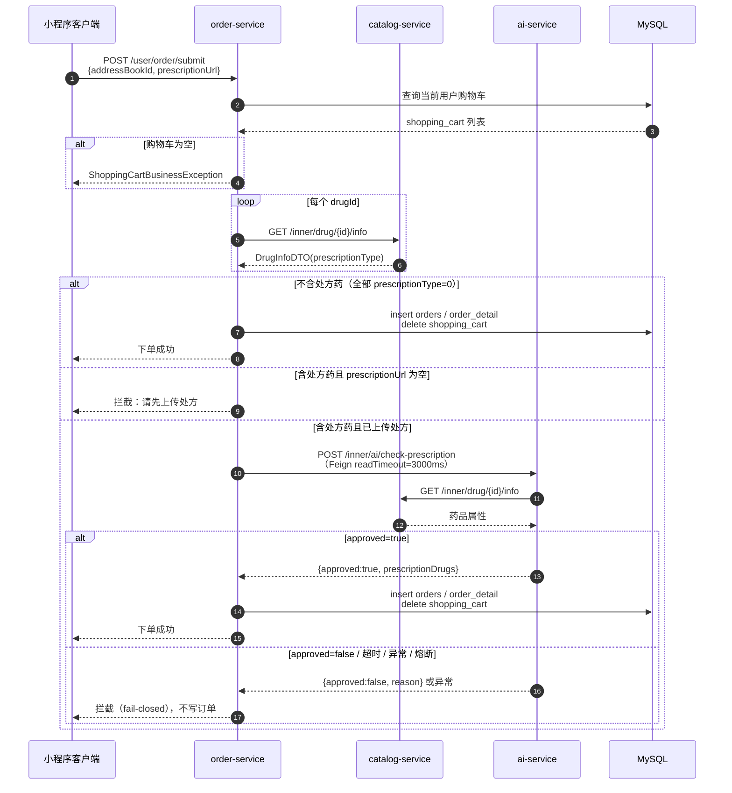

# AI 接入网关与 SSE 流式输出改造记录

> 日期：2026-10-21  
> 范围：`ysd-gateway`、`ysd-ai-service`  
> 目标：消灭 AI 服务“裸奔”，补齐 JWT 鉴权与身份透传；把阻塞式问答改造为 SSE 逐块输出；回传 `conversationId` 支撑多轮对话。

---

## 1. 改造前的问题

| 问题 | 影响 |
| --- | --- |
| AI 服务 `:8088` 直连，不经过网关 | 知道 IP 即可无限调用，消耗 DeepSeek Token |
| 没有 JWT 校验 | 无法确认调用方身份，也无法按用户限流/审计 |
| `conversationId` 只在服务端生成 | 客户端拿不到，多轮对话无法续接 |
| 问答是阻塞式 `.call()` | 首字延迟 = 完整答案生成时间，体验差；长时间占用 Tomcat 线程 |

---

## 2. 总体方案

```text
客户端
  │  authentication: <用户 JWT>
  ▼
ysd-gateway :9000
  │  1. AuthGlobalFilter 校验用户 JWT
  │  2. 剥离客户端伪造的 X-Identity-Id
  │  3. 注入可信 X-Identity-Id
  ▼
ysd-ai-service :8088
  │  4. IdentityGuardFilter 校验 X-Identity-Id（拒绝直连）
  │  5. ChatClient.stream() → Flux<String>
  │  6. 映射为 Flux<ServerSentEvent<String>>
  ▼
SSE: event:message / event:done / event:error
```

关键取舍：**保留 Servlet（Tomcat）运行模型，只引入 WebFlux 的响应式类型做 SSE 输出**。
原因：

- AI 服务现有 Tool 调用走 Feign、RAG 走 Jedis，均为阻塞式；整体切 WebFlux 会让阻塞调用落到 Netty 事件循环上；
- Spring MVC 6.2 原生支持 `Flux<ServerSentEvent<T>>` 返回值，内部通过 `SseEmitter` 异步写出，请求线程在订阅后立即释放；
- 流数据先 `publishOn(Schedulers.boundedElastic())` 再写响应，避免慢客户端拖住模型客户端的事件循环。

---

## 3. P1：网关路由与鉴权

### 3.1 路由配置

文件：`ysd-gateway/src/main/resources/application.yaml`

```yaml
- id: ysd-ai-service
  uri: lb://ysd-ai-service
  predicates:
    - Path=/ai/**
  order: -1
```

- 通过 Nacos 服务发现 + `lb://` 负载均衡转发到 `ysd-ai-service`；
- 与现有路由一致**不剥离前缀**：AI 控制器本身声明 `/ai/drug`、`/ai/prescription`；
- `Path=/ai/**` 与原有 `/admin/**`、`/user/**`、`/ws/**` 无交集，回归测试 `/user/shop/status` 仍返回 200。

### 3.2 鉴权复用

未修改 `AuthGlobalFilter` 的判定逻辑：

- `/ai/**` 不在白名单；
- 非 `/admin/` 前缀，自动走用户端分支：读取 `authentication` 头，用 `user-secret-key` 校验；
- 校验通过后将 `claims.userId` 写入 `X-Identity-Id`；
- 请求进入过滤器时先移除客户端自带的 `X-Identity-Id`，防止伪造。

因此客户端**无法通过请求体或请求头指定 userId**。

### 3.3 服务端兜底

新增 `IdentityGuardFilter`（`ysd-ai-service`）：

- 仅拦截 `/ai/**`；
- 缺少 `X-Identity-Id` 直接返回 `401 {"code":401,"msg":"缺少网关身份头，请通过网关访问"}`；
- 部署时应将 `:8088` 限制在内网/网关网段，应用层过滤器作为第二道防线。

### 3.4 验证结果

无 token 经网关请求：


```text
HTTP/1.1 401 Unauthorized
{"code":401,"msg":"未登录或登录已过期","data":null}
```

绕过网关直连 `:8088`：

```text
HTTP/1.1 401
{"code":401,"msg":"缺少网关身份头，请通过网关访问","data":null}
```

证据文件：

- `docs/05-测试与压测/evidence/AI-day2-01-gateway-401-20261021.txt`
- `docs/05-测试与压测/evidence/AI-day2-02-direct-401-20261021.txt`

---

## 4. P2：SSE 流式输出

### 4.1 接口

| 方法 | 路径 | 返回 | 用途 |
| --- | --- | --- | --- |
| POST | `/ai/drug/chat` | `Result<AiAnswerVO>` | 阻塞式，兼容不支持 SSE 的客户端 |
| POST | `/ai/drug/chat/stream` | `Flux<ServerSentEvent<String>>` | 流式输出 |
| GET | `/ai/drug/query` | `Result<String>` | 旧接口，保留兼容 |

### 4.2 事件约定

| event | data | 说明 |
| --- | --- | --- |
| `message` | 增量文本 | 直接拼接渲染 |
| `done` | `{"conversationId":"..."}` | 流结束，回传会话 ID |
| `error` | 错误提示 | 模型/下游异常、限流、参数错误 |

`conversationId` 同时放在响应头 `X-Conversation-Id`，客户端在首块到达前即可拿到。

### 4.3 核心实现

```java
Flux<ServerSentEvent<String>> body = chatClient.prompt()
        .user(message)
        .tools(drugQueryTool)
        .advisors(a -> a.param(ChatMemory.CONVERSATION_ID, memoryKey))
        .stream()
        .content()
        .publishOn(Schedulers.boundedElastic())
        .map(chunk -> ServerSentEvent.<String>builder(chunk).event("message").build())
        .concatWith(Mono.fromSupplier(() -> doneEvent(conversationId)))
        .timeout(Duration.ofSeconds(120))
        .onErrorResume(e -> Mono.just(errorEvent("AI 服务繁忙，请稍后再试。")));
```

配置补充：

```yaml
spring:
  mvc:
    async:
      request-timeout: 180000
```

`pom.xml` 显式声明 `spring-webflux`（非 starter），只使用其类型，不切换 Web 容器。

### 4.4 验证

请求：

```bash
curl -N -X POST http://localhost:9000/ai/drug/chat/stream \
  -H "authentication: <token>" \
  -H "Content-Type: application/json; charset=UTF-8" \
  -H "Accept: text/event-stream" \
  --data-binary @.tmp-ai-req1.json
```

响应头：

```text
HTTP/1.1 200 OK
Cache-Control: no-cache
X-Accel-Buffering: no
X-Conversation-Id: 7f66698b-36e6-48ee-946e-bb6284088f64
Content-Type: text/event-stream
```

响应体（节选）：

```text
event:message
data:关于

event:message
data:阿

event:message
data:莫
...

event:done
data:{"conversationId":"7f66698b-36e6-48ee-946e-bb6284088f64"}
```

逐块到达时间（Python 客户端打点，节选）：

```text
HTTP 200 content-type=text/event-stream
X-Conversation-Id=e860cdec-0039-42b6-9afc-8a48edab204a
+ 1701.9 ms | event:message
+ 1701.9 ms | data:关于
+ 1711.5 ms | event:message
+ 1711.7 ms | data:阿
+ 1763.7 ms | event:message
+ 1763.9 ms | data:，
```

首块约 1.7s 到达，后续持续增量下发，不是生成完整答案后一次性返回。


证据文件：

- `docs/05-测试与压测/evidence/AI-day2-03-chat-blocking-20261021.txt`
- `docs/05-测试与压测/evidence/AI-day2-04-sse-stream-20261021.txt`
- `docs/05-测试与压测/evidence/AI-day2-05-sse-timing-20261021.txt`

---

## 5. P3：conversationId 回传与多轮记忆

### 5.1 返回结构

```java
public record AiAnswerVO(String conversationId, String answer) {}
```

- 首次请求不传 `conversationId`，服务端生成 UUID；
- 后续请求回传该 ID，服务端用它定位 `MessageWindowChatMemory` 中的最近 20 条消息；
- 阻塞接口放在响应体中，SSE 接口放在 `event:done` 与 `X-Conversation-Id` 响应头中。

### 5.2 用户维度隔离

客户端回传的 ID 不可信。记忆键采用：

```text
<网关注入的 userId>:<conversationId>
```

同时校验 `conversationId` 仅允许 `[A-Za-z0-9_-]{1,64}`，非法值重新生成。
即使两个用户拿到同一个 `conversationId`，也不会读到对方的对话历史。

### 5.3 多轮验证

第一轮（无 conversationId）：

```text
问：阿莫西林有什么副作用
答：平台在售的是阿莫西林胶囊（石药集团…），为处方药。
    适应症：…；禁忌：青霉素过敏者禁用。
    平台数据未收录不良反应清单……
conversationId: a59b44a9-cf55-488a-bd9f-c8f38d0c45fc
```

第二轮（回传上一轮 conversationId）：

```text
问：这个药多少钱？
答：您询问的是阿莫西林胶囊的价格，但平台药品数据中并未收录价格信息……
```

AI 能正确把“这个药”解析为上一轮的阿莫西林胶囊，说明记忆生效。


### 5.4 隔离验证

用户 5 复用用户 4 的 `conversationId` 问“这个药多少钱？”：

```text
答：您好，您没有说明具体是哪款药品，我无法直接给出价格……
```

未继承用户 4 的上下文，隔离生效。

证据文件：

- `docs/05-测试与压测/evidence/AI-day2-06-multiturn-20261021.txt`
- `docs/05-测试与压测/evidence/AI-day2-07-isolation-20261021.txt`

---

## 6. 测试结果汇总

| 用例 | 期望 | 结果 |
| --- | --- | --- |
| 网关 `/ai/**` 无 token | 401 | 通过 |
| 直连 `:8088` 无 `X-Identity-Id` | 401 | 通过 |
| 合法 token + 阻塞问答 | 200，返回真实药品数据 + conversationId | 通过（约 3.8s，含 Tool 调用） |
| 合法 token + SSE | 200，`text/event-stream`，逐块返回 | 通过（首块约 1.7s） |
| 多轮对话 | 结合上文回答 | 通过 |
| 跨用户复用 conversationId | 不继承他人上下文 | 通过 |
| 既有网关路由 `/user/shop/status` | 200 | 通过（无回归） |

---

## 7. 改造文件清单

| 文件 | 改动 |
| --- | --- |
| `ysd-gateway/src/main/resources/application.yaml` | 新增 `/ai/**` → `lb://ysd-ai-service` 路由 |
| `ysd-ai-service/pom.xml` | 显式引入 `spring-webflux`（仅类型，不切容器） |
| `ysd-ai-service/src/main/resources/application.yml` | SSE 异步超时 180s |
| `ysd-ai-service/.../controller/AiDrugController.java` | 新增 `/chat`、`/chat/stream`，回传 conversationId，用户维度记忆 |
| `ysd-ai-service/.../controller/dto/AiChatRequest.java` | 请求体 |
| `ysd-ai-service/.../controller/vo/AiAnswerVO.java` | 阻塞式返回体 |
| `ysd-ai-service/.../filter/IdentityGuardFilter.java` | 校验网关注入的身份头 |
| `README.md` | AI 接口示例改为经网关访问 |

---

## 8. 遗留问题与后续演进

1. **会话记忆是单机内存**：`MessageWindowChatMemory` 默认 `InMemoryChatMemoryRepository`，AI 服务多实例时同一会话会漂移。
   下一步可替换为 Redis / JDBC 实现，键继续沿用 `userId:conversationId`。
2. **SSE 经 Nginx**：已返回 `X-Accel-Buffering: no`，但仍需在 Nginx 关闭 `proxy_buffering` 并放宽 `proxy_read_timeout`。
3. **Sentinel**：流式接口使用 `@SentinelResource(value="aiStream")`，限流粒度是“请求数”，不是 Token 数；如需成本控制，可增加按用户/Token 的配额。
4. **连通性与压测**：本次仅验证本地单实例；多实例、断线重连、网关超时需在压测环境补充。
5. **Zipkin 未运行**：启动日志中的 `ConnectException` 来自 span 上报失败，不影响业务。

---

## 9. 复现步骤

```bash
# 1. 构建
mvn -pl ysd-gateway,ysd-ai-service -am -DskipTests package

# 2. 启动（需 Nacos / Redis / Ollama / DeepSeek Key）
java -jar ysd-gateway/target/ysd-gateway-1.0-SNAPSHOT.jar
DEEPSEEK_API_KEY=sk-xxx java -jar ysd-ai-service/target/ysd-ai-service-1.0-SNAPSHOT.jar

# 3. 生成测试 token 与 UTF-8 请求体
TOKEN=$(python jmeter/gen-user-token.py 4)
printf '%s' '{"message":"阿莫西林有什么副作用"}' > /tmp/ai-req.json

# 4. 阻塞式
curl -X POST http://localhost:9000/ai/drug/chat \
  -H "authentication: $TOKEN" -H "Content-Type: application/json; charset=UTF-8" \
  --data-binary @/tmp/ai-req.json

# 5. 流式
curl -N -X POST http://localhost:9000/ai/drug/chat/stream \
  -H "authentication: $TOKEN" -H "Content-Type: application/json; charset=UTF-8" \
  -H "Accept: text/event-stream" --data-binary @/tmp/ai-req.json
```

---

## 10. 业务闭环：下单处方药拦截（Day 4）

### 10.1 改造前的问题

`/ai/prescription/check` 只是一个**独立接口**：用户可以直接调用 `order-service` 的 `/user/order/submit`，完全绕过 AI 审核把处方药买走。Day 4 把审核从“可选接口”变成下单主流程的**强制闸门**。

### 10.2 调用点与判定顺序

调用点在 `OrderServiceImpl.submitOrder`：查到购物车之后、写 `orders` 之前。

1. 从购物车提取 `drug_id`（去重、忽略 null）；
2. 通过 `CatalogClient.getDrugInfoById` 查询每个药品的 `prescriptionType`；
3. 不含 `prescriptionType=1`：直接放行，不调用 AI（OTC 无额外延迟）；
4. 含处方药但 `OrdersSubmitDTO.prescriptionUrl` 为空：直接抛 `OrderBusinessException("购物车包含处方药，请先上传处方后再下单")`；
5. 含处方药且已带处方：调用 `POST /inner/ai/check-prescription`；
6. AI 返回 `approved=false`、超时、熔断或任何异常：一律抛业务异常，**不写订单**（fail-closed）。

### 10.3 时序图



### 10.4 AI 内部审核接口

`POST /inner/ai/check-prescription`

```json
// request
{ "drugIds": [51], "prescriptionUrl": "https://oss.example.com/rx/1.jpg", "userId": 4 }

// response
{ "approved": true, "reason": "处方已上传，合规校验通过，待药师复核",
  "prescriptionDrugs": ["阿莫西林胶囊"] }
```

设计取舍：**同步链路不调用大模型**。下单 Feign 超时只有 3 秒，而一次 RAG + LLM 往返无法稳定满足；审核结论必须确定性。因此内部接口只做规则校验（药品属性 + 处方凭证是否上传 + 下游可用性），大模型/RAG 仍保留在用户侧咨询和异步人工复核。

`/inner/ai/**` 不在网关路由范围（网关只路由 `/ai/**`），只能通过 Nacos 在服务内网访问。

### 10.5 超时与降级

`ysd-order-service` 配置：

```yaml
spring.cloud.openfeign.client.config:
  ysd-ai-service:
    connectTimeout: 1000
    readTimeout: 3000
  ysd-catalog-service:
    connectTimeout: 1000
    readTimeout: 2000
```

- `AiPrescriptionClientFallbackFactory`：熔断时返回 `approved=false`，不抛异常，统一按“审核不通过”处理；
- `OrderServiceImpl` 仍用 try/catch 包住 Feign 调用，防止 fallback 未生效时的连接异常穿透；
- 涉及处方药安全，**超时/异常必须 fail-closed**，不能默认放行。

### 10.6 验证结果

单元测试（`mvn -pl ysd-order-service test -Dtest=OrderPrescriptionAuditTest`）：6/6 通过。

| 场景 | 期望 | 结果 |
| --- | --- | --- |
| 购物车只有 OTC | 正常下单，不调用 AI | ✅ |
| 含处方药、未上传处方 | 拦截，不写订单 | ✅ |
| 含处方药 + AI approved | 正常下单，请求包含 drugIds/url/userId | ✅ |
| AI 返回 approved=false | 按 AI reason 拦截 | ✅ |
| AI 超时/抛异常 | fail-closed 拦截 | ✅ |
| catalog 查询失败 | 无法判断属性，fail-closed | ✅ |

真实链路（本地启动 catalog/order/ai）：OTC 下单成功；处方药无 `prescriptionUrl` 被拦截；带凭证 + AI 通过后下单成功；**停掉 AI 服务后 0.11s 返回拦截**，未写订单。详见 `docs/05-测试与压测/T31-AI失败路径测试记录.md`。

### 10.7 当前边界

- **药品组合未覆盖**：购物车行 `drug_id` 为 null、只有 `combo_id` 时，当前不会触发处方审核；如果组合中包含处方药，需要扩展 combo 快照或组合明细查询。
- **处方真实性未校验**：`prescriptionUrl` 只校验“是否上传/长度”，不做 OCR、签章或药师人工核验；真实上线需接入处方审核服务或异步人工复核。
- **处方凭证未落库**：目前只在下单请求内传递，订单表没有 `prescription_url` 字段；如需审计追踪，应增加列并保存脱敏后的引用。
- **catalog 是单点前置依赖**：catalog 不可用时所有药品订单都会被 fail-closed 拦截（包括 OTC），这是安全优先的取舍，后续可通过本地药品属性缓存降低影响。
