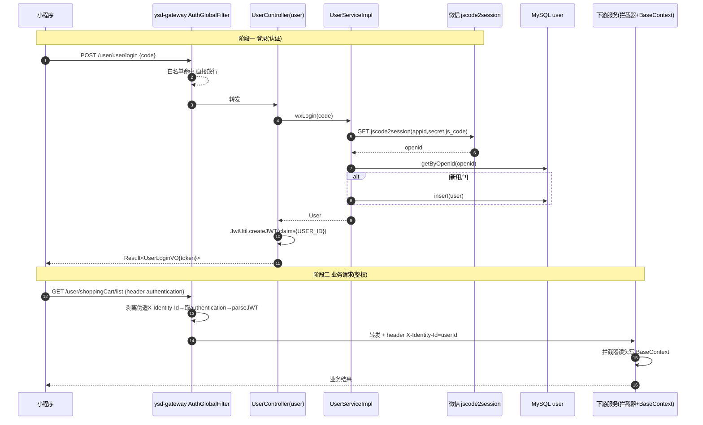
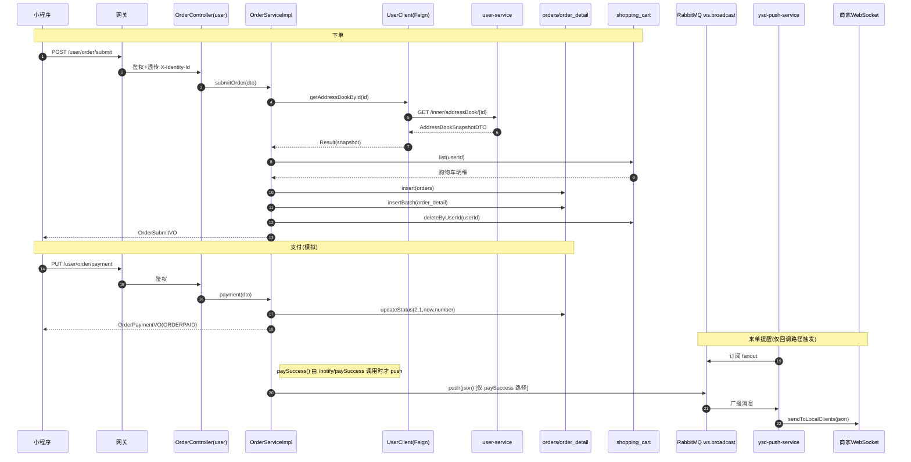
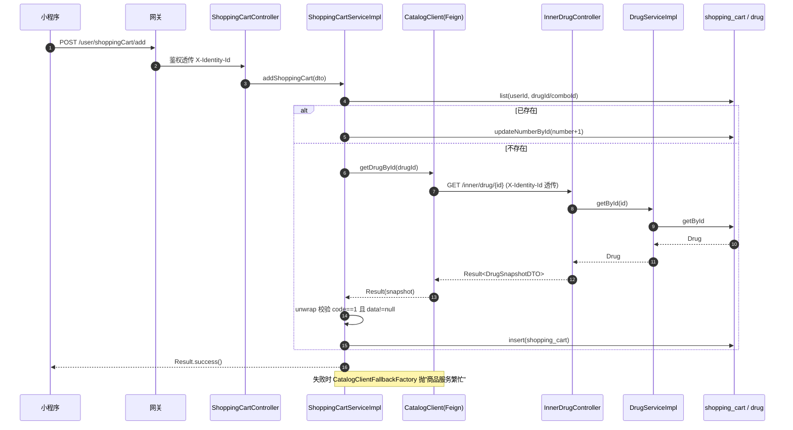
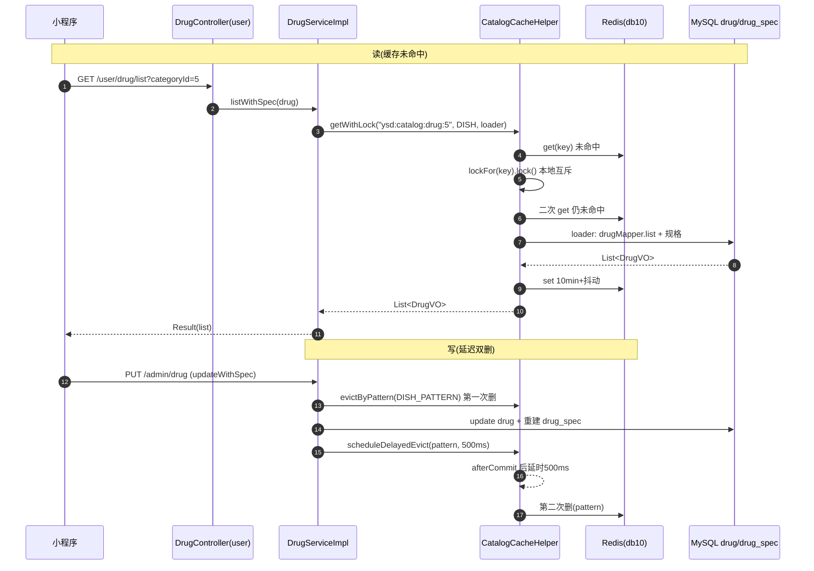

# 03 · 核心业务链路深度解析

> 本文全部基于当前仓库源码逐行核对，标注 `文件:行号`。三类结论用标记区分：
> - **【源码确认】** 可在代码中直接验证。
> - **【静态推断】** 由代码结构推导的风险，未运行验证。
> - **【需运行验证】** 必须启动/压测才能下结论。
>
> 校对基线：`main`，2026-10-13。链路 4 组：①登录鉴权 ②下单+支付提醒 ③加购物车跨服务 ④药品缓存。
> 每条链路的「面试口语回答」刻意保守，不夸大并发量/生产经验。
>
> 📌 **基线说明**：本系列源码分析基线早于 AI 模块引入，关于 AI 模块的源码与架构详见 [`docs/02-架构设计与开发/`](../02-架构设计与开发/)。

---

# 链路一 · 用户登录与鉴权

## 1.1 业务场景与入口

- **登录**（认证，authentication）：用户在小程序授权后，前端拿 `code` 换后端 token。
- **后续请求**（鉴权，authorization）：前端每次带 token，网关验签 + 透传身份，服务端写入线程上下文。
- 入口接口：`POST /user/user/login`；管理端对应 `POST /admin/employee/login`。

> ⚠️ 关键区分：**「登录」只发生一次，签出 token；「鉴权」发生在之后每一次业务请求**。面试最容易被追问的就是这一点。

## 1.2 调用链（源码确认）

```
前端 POST /user/user/login {code}
 → ysd-gateway AuthGlobalFilter.filter():50
     白名单命中 "/user/user/login"（:39-47, 判定 :68-69）→ 直接放行，不做校验
 → ysd-user-service UserController.login():42-62
     → UserServiceImpl.wxLogin():38
         → getOpenid():72  → HttpClientUtil.doGet(api.weixin.qq.com/sns/jscode2session)
         → UserMapper.getByOpenid(openid)  [UserMapper.java:17]
         → 新用户则 userMapper.insert()
     → JwtUtil.createJWT(userSecretKey, userTtl, claims{USER_ID})  [:53]
 → 返回 UserLoginVO{id, openid, token}
```

**后续请求**（例：加购物车）：

```
前端 携带 header authentication: <token>
 → AuthGlobalFilter.filter():50
     1) 剥离客户端自带的 X-Identity-Id（:52-56，防伪造）
     2) 非白名单、非 /inner/**，path 不以 /admin/ 开头 ⇒ isAdmin=false（:75）
     3) 取 header "authentication"（:82）
     4) JwtUtil.parseJWT(userSecretKey, token) 取 USER_ID（:96-101）
     5) 写入新请求头 X-Identity-Id（:105-107）转发下游
 → 下游 JwtTokenUserInterceptor.preHandle():36
     6) 先读 X-Identity-Id → BaseContext.setCurrentId()（:49-55）
     （若直连无此头，才自解析 token，:57-73；失败置 401 返回 false）
 → Controller/Service 用 BaseContext.getCurrentId() 取当前用户
```

## 1.3 时序图



## 1.4 逐步执行过程与设计原因

| 步骤 | 代码 | 为什么这样写 |
|---|---|---|
| 白名单放行登录 | `AuthGlobalFilter:39-47` | 登录时还没有 token，若走校验必然 401 |
| 剥离 `X-Identity-Id` | `AuthGlobalFilter:52-56` | **安全关键**：客户端可伪造该头冒充任意用户，必须在网关先删再加入可信值 |
| token 名分双端 | `:79-83` | 管理端 `token`、用户端 `authentication`，两套密钥分开，互不越权 |
| 网关验签并透传 id | `:96-107` | 下游服务无需重复持有密钥；`lb://` 下游只信网关 |
| 服务端兜底自解析 | `JwtTokenUserInterceptor:57-73` | 允许绕过网关直连调试（如 Postman 打 8081） |
| SHA-256 派生密钥 | `JwtUtil:25-33` | jjwt 0.12 对 HS256 强校验 ≥32 字节；配置的 `<JWT_ADMIN_SECRET>` 太短，统一摘要后再用 |
| 上下文用 ThreadLocal | `BaseContext:3-17` | 同一请求线程内随处取 userId，避免层层传参 |

## 1.5 事务 / 异常 / 返回 / 配置

- **事务**：登录无 `@Transactional`（仅一次查询 + 可能一次 insert，无需事务）。
- **异常**：openid 为空 → `LoginFailedException`（`UserServiceImpl:44-46`）；管理端密码错 → `PasswordErrorException`（`EmployeeServiceImpl:57-60`）。
- **返回**：`Result<UserLoginVO>`，`code=1` 成功（`Result.java:24-29`）。
- **配置**：`ysd.jwt.user-secret-key/user-ttl/user-token-name`（user 服务 `application.yml:33-37`）；网关同名配置须一致（`gateway/application.yaml:71-78`），**不一致则网关解析 401**。
- **管理端登录**：`EmployeeServiceImpl.login():41-69`，密码 `DigestUtils.md5DigestAsHex` 比对；token 用 `admin-secret-key`。

## 1.6 失败场景与排查

### 场景 A：登录成功但后续请求 401
- **先看**：前端是否把 token 放对 header（user 端必须是 `authentication`，不是 `Authorization`）。
- **验证**：`curl -v` 打网关 9000，观察请求头名；对比 `AuthGlobalFilter:82`。
- **定位**：若头对仍 401，检查网关与服务端 `user-secret-key` 是否一致。
- **修复**：统一配置（最好抽到 Nacos 配置中心）。

### 场景 B：网关验签失败（token 有效期/密钥问题）
- **先看**：网关日志 `JWT 校验失败: {}`（`AuthGlobalFilter:113`）。
- **验证**：token 是否过期（`user-ttl=7200000`=2h）；是否升级 jjwt 前签发的旧 token（密钥算法变了，见 `JwtUtil:23` 注释）。
- **修复**：重新登录；确认 config 与网关一致。

### 场景 C：直连服务端口能过、走网关 401 / 反之
- **原因**：服务端拦截器「优先读 X-Identity-Id，无则自解析」（`JwtTokenUserInterceptor:49-73`）。
- **验证**：直连 8081 带 token 应通；直连不带 token 应 401。
- **【静态推断】** 若有人直连服务端口并伪造 `X-Identity-Id`，**服务端不做校验**（只读头）——绕过网关即可冒充用户。生产应禁止业务端口对外暴露。

### 场景 D：`/inner/**` 被外部访问
- **现象**：403 `无权限访问`（`AuthGlobalFilter:63-65`）。
- **排查**：这是**预期行为**，内网接口只给 Feign 用。

### 场景 E：`BaseContext` 拿到的 id 是 null
- **原因**：`ThreadLocal` 未清理或异步线程未传递（Feign 默认同线程，异步客户端会丢，见 `FeignRequestInterceptor:10-11` 注释）。
- **验证**：在 Service 打日志看 `BaseContext.getCurrentId()`。

## 1.7 结论分级
- **【源码确认】** 白名单、双 token 名、剥离伪造头、SHA-256 派生、拦截器优先读头。
- **【静态推断】** 直连端口伪造 `X-Identity-Id` 可绕过鉴权（需服务端口不对外）。
- **【需运行验证】** 网关与服务端密钥不一致时的实际报错链路。

## 1.8 面试口语回答（保守版）

> "登录和鉴权是两回事。小程序登录时调 `/user/user/login`，后端拿 code 去微信换 openid，查库没有就自动注册，然后用 jjwt 签一个以用户 id 为 claim 的 token 返回。
> 拿到 token 后，前端每个请求都把它放在 `authentication` 头里。请求进网关时，`AuthGlobalFilter` 是个全局过滤器，它先把客户端可能伪造的 `X-Identity-Id` 头删掉，再按路径判断是管理端还是用户端，用对应的密钥验签，验过后把真实用户 id 写进 `X-Identity-Id` 转发给下游。
> 下游服务有个拦截器，优先读这个头写进 ThreadLocal 的 BaseContext，业务代码用 `BaseContext.getCurrentId()` 拿当前用户；如果没经过网关直连，它也能自己验 token 兜底。
> 密钥和 token 名都配在 yml 里，网关和各服务必须一致，否则网关就 401。"

**追问 1**：为什么网关要删 `X-Identity-Id`？
> "因为这个头是下游信任的身份来源。如果不删，客户端自己带一个 `X-Identity-Id: 1`，网关又不覆盖就直接转发，就能冒充用户 1。所以必须在鉴权前先剥离，验签后再写入可信值。"

**追问 2**：为什么你们用 SHA-256 处理密钥？
> "jjwt 0.12 开始对 HS256 密钥有 32 字节的强校验，而项目配置里是 `<JWT_ADMIN_SECRET>` 这种短密钥。直接传会抛 WeakKeyException，所以统一先做一次 SHA-256 摘要，得到 32 字节。代价是升级后旧 token 签名对不上会失效，需要重新登录。"

**追问 3**：服务端拦截器为什么还要自己解析 token？
> "主要是为了兼容不经过网关的直连调试。拦截器先看有没有网关透传的 `X-Identity-Id`，有就直接用；没有就退回到自己用配置的密钥解析 token。这是兜底，生产环境理论上应该只让流量走网关。"

## 1.9 自测题
1. 「登录」和「鉴权」各发生在哪一次请求？分别由哪个类负责？
2. token 里放了什么 claim？用什么密钥签的？为什么密钥要 SHA-256？
3. 网关在鉴权前删除 `X-Identity-Id` 的目的是什么？如果不删会怎样？
4. 服务端拦截器取用户 id 的两条分支是什么？哪条优先？
5. 管理端和用户端 token 的头名、密钥、TTL 分别在哪配置？不一致会怎样？

---

# 链路二 · 用户下单与支付提醒

## 2.1 业务场景与入口

- **下单**：用户从购物车结算，生成订单 + 明细，清空购物车。
- **支付**：**当前为模拟支付**（真微信调用被注释），前端调 `/user/order/payment` 直接把订单置为"已支付/待接单"。
- **来单提醒**：本应由微信回调 `/notify/paySuccess` 触发 RabbitMQ→WebSocket 推送给商家端。
- 入口：`POST /user/order/submit`、`PUT /user/order/payment`、`POST /notify/paySuccess`。

## 2.2 下单调用链（源码确认）

```
POST /user/order/submit
 → 网关鉴权 → order JwtTokenUserInterceptor → BaseContext = userId
 → OrderController.submit():29-37
 → OrderServiceImpl.submitOrder():69  @Transactional(rollbackFor=Exception.class)
     1) UserClient.getAddressBookById(addressBookId)      :74   ← Feign 跨服务
          → POST/GET http://ysd-user-service/inner/addressBook/{id}
          → InnerAddressBookController.getById():24-32
          → AddressBookService.getById → 返回 AddressBookSnapshotDTO(consignee,phone)
        unwrap(...) 校验 code==1，否则抛业务异常            :539-544
     2) 校验地址簿、购物车非空                            :75-90
     3) ShoppingCartMapper.list(userId)                    :84   [XML:7-23]
     4) 组装 Orders，number=System.currentTimeMillis()     :93-101
     5) OrderMapper.insert(orders)                          :103  [XML:6-14, useGeneratedKeys 回填 id]
     6) 购物车 → OrderDetail 列表                          :105-112
        OrderDetailMapper.insertBatch(list)                 :115  [XML:7-13]
     7) ShoppingCartMapper.deleteByUserId(userId)          :117  [注解 SQL]
     8) 返回 OrderSubmitVO{id,orderNumber,amount,orderTime} :120-127
```

## 2.3 支付与提醒调用链（源码确认 + 关键折损）

```
PUT /user/order/payment
 → OrderController.payment():45-52
 → OrderServiceImpl.payment():136
     // 【源码确认】真正的 weChatPayUtil.pay(...) 被注释掉（:138-147）
     // 直接构造 code=ORDERPAID 的 VO（:149-152）
     → OrderMapper.updateStatus(TO_BE_CONFIRMED=2, PAID=1, now, orderNumber)  :165
        [注解 SQL OrderMapper.java:58-60]
     ← 注意：此路径【不触发】WebSocket 推送

（真实回调路径，需微信/模拟回调触发）
POST /notify/paySuccess
 → PayNotifyController.paySuccessNotify():37-58
     → readData(:67) → decryptData(:87) 用 weChatProperties.getApiV3Key()
     → orderService.paySuccess(outTradeNo):175
         → OrderMapper.getByNumber → OrderMapper.update(status=2,payStatus=1)
         → WsPushProducer.push(json)  :198  → RabbitMQ ws.broadcast
 → ysd-push-service WsPushListener.onMessage():24 → WebSocketServer.sendToLocalClients():67
 → 小程序 ws://网关:9000/ws/{sid}
```

## 2.4 时序图



## 2.5 逐步执行与设计原因

| 步骤 | 代码 | 为什么这样 |
|---|---|---|
| 跨服务取地址 | `OrderServiceImpl:74` + `InnerAddressBookController:24` | 地址属 user 域，order 不直连其表；用 Feign 走 `/inner` 内网接口 |
| fail-fast 拆包 | `unwrap():539-544` | Feign 返回统一 `Result`，非 1 直接抛业务异常（阶段 5 无降级，宁可失败不写错数据） |
| 订单号=毫秒时间戳 | `:98` | 简单唯一，但**并发同毫秒会重复**（见失败场景 F） |
| `insert` 回填 id | `OrderMapper.xml:6` `useGeneratedKeys` | 后续明细要 `orderId=orders.getId()` |
| 明细从购物车复制 | `:107-112` | 购物车是"下单来源"，明细落库后与购物车解耦 |
| 下单即清购物车 | `:117` | 保证同一批商品不会重复下单 |
| 支付改状态 | `payment():165` `updateStatus` | **模拟支付**：跳过微信，直接置状态 |
| 提醒解耦 | `WsPushProducer:25` 发 MQ | order 与 push 解耦，push 可多实例 |

## 2.6 事务 / 异常 / 返回 / 配置

- **事务边界**：`submitOrder` 的 `@Transactional(rollbackFor=Exception.class)`（`:69`）覆盖步骤 1–7；**异常（含业务异常、SQL 异常）都会回滚**。
  - ⚠️ **【静态推断】Feign 远程调用在事务内**：地址查询在本地事务开启后执行 → **长事务风险**（远程 RT 计入事务时长、DB 连接被占用）。改进：先远程查快照再开事务，或加事务超时。
- **异常**：地址空 → `AddressBookBusinessException`；购物车空 → `ShoppingCartBusinessException`；Feign 失败 → `OrderBusinessException`（`unwrap`）。
- **返回**：`Result<OrderSubmitVO>`。
- **配置**：`order/application.yml` 的 `spring.cloud.openfeign.circuitbreaker.enabled=true`（:36-38）开启熔断。
- **`@AutoFill` 不作用于订单**：注解仅在 `Employee/Category/Drug/DrugCombo` 的 Mapper（`grep @AutoFill` 确认），`orders` 表无 `create_time` 等列，故订单插入不自动填充。

## 2.7 失败场景与排查

### 场景 A：下单报「地址查询失败」
- **先看**：order 日志的 `unwrap` 抛出信息（`OrderServiceImpl:541`）；商品服务/用户服务是否在 Nacos 注册。
- **验证**：`curl http://localhost:8081/inner/addressBook/1`（内网接口，需直连服务端口）。
- **定位**：Feign 走 `/inner`，若 user-service 未启动/未注册 → 连接失败。
- **修复**：确保 user-service 在线；必要时核对 `FeignRequestInterceptor` 透传头。

### 场景 B：购物车为空仍下单
- **现象**：`下单失败：购物车为空`。
- **验证**：查 `shopping_cart where user_id=?`（注意用的是 `BaseContext` 的 id）。
- **定位**：可能已下过单被清空，或 `userId` 取错。

### 场景 C：订单插入成功但明细为空 / 部分失败
- **原因**：`insertBatch` 是**一条 SQL 多 values**（`OrderDetailMapper.xml:7-13`），整批成功或整批失败；若购物车本身为空则明细列表空 → insertBatch 可能生成非法 SQL。
- **验证**：查 `order_detail where order_id=?`。
- **修复**：`submitOrder` 已先校验购物车非空（`:87-90`），正常不会触发。

### 场景 D：支付后商家端没收到来单提醒
- **原因**：**【源码确认】**模拟支付走 `payment()→updateStatus`，**不经过 `paySuccess()`，所以不 push**。只有 `/notify/paySuccess` 才会 `WsPushProducer.push`。
- **验证**：查 RabbitMQ 是否有 `ws.broadcast` 消息；看 order 日志是否打印 mq push。
- **定位**：确认前端支付最终是否调用 `/notify/paySuccess`（真实微信会调；模拟环境不会）。
- **修复/说明**：这是当前实现与"真实支付"的差距，面试要如实说。

### 场景 E：`/notify/paySuccess` 解密 NPE
- **原因**：**【静态推断】** `decryptData():94` 用 `weChatProperties.getApiV3Key()`，但 order/user 的 `application.yml` **未配置 `ysd.wechat.api-v3-key`** → `getBytes` 空指针。
- **验证**：调用该接口看异常栈；或检查配置项是否存在 `api-v3-key`。
- **修复**：补齐 `ysd.wechat.apiV3Key` 等支付证书配置（本仓库未实现真实支付，此为遗留）。

### 场景 F：并发下单订单号重复
- **原因**：**【静态推断】** `number=System.currentTimeMillis()`（`:98`），同毫秒并发会碰撞；`orders.number` 无唯一约束（建表语句 `backup_*.sql` 未见 UNIQUE）。
- **验证**：并发压测观察 `number` 是否重复。
- **修复**：改用雪花 ID / UUID / 带自增序列的订单号，并给 `number` 加唯一索引。

## 2.8 结论分级
- **【源码确认】** 真微信支付被注释、`payment` 直改状态、`paySuccess` 才 push、事务覆盖 1–7、`@AutoFill` 不含订单。
- **【静态推断】** 事务内远程调用（长事务）、订单号并发重复、`apiV3Key` 未配置导致回调 NPE。
- **【需运行验证】** 并发下单号重复概率、MQ 在无消费者时消息行为。

## 2.9 面试口语回答（保守版）

> "下单接口进 order-service 后，`submitOrder` 加了 `@Transactional(rollbackFor=Exception.class)`。流程是：先用 Feign 调 user-service 的内网接口拿地址簿快照（收货人、电话）——因为地址属于用户域，订单服务不直连用户的表；Feign 返回统一 Result，我封了个 `unwrap`，非成功码就抛业务异常。
> 然后取当前用户购物车，校验非空，组装订单插入 orders，再把购物车每条复制成订单明细批量插入 order_detail，最后清空购物车，整体在一个事务里，任一步失败都回滚。
> 支付这块我要如实说：项目里真正的微信支付调用是被注释掉的，`payment` 方法现在是直接构造一个 ORDERPAID 的返回，并调用 `updateStatus` 把订单改成已支付、待接单，所以它其实没有接真实微信支付。
> 来单提醒是另一条路：真实情况下微信回调 `/notify/paySuccess`，那里会更新订单并调用 `WsPushProducer` 发一条消息到 RabbitMQ 的 `ws.broadcast` 广播交换机，独立的 push-service 消费后再用 WebSocket 推给商家端。所以模拟支付路径本身是不会触发推送的。"

**追问 1**：下单事务里为什么先远程查地址？有什么问题？
> "为了让订单落库时就带上收货人和电话快照。但远程调用放在了事务内部，会拉长事务持有时间、占用数据库连接，属于长事务风险。更好的做法是先把地址查出来，再开启事务写库。"

**追问 2**：订单号怎么生成的？会重复吗？
> "现在是用 `System.currentTimeMillis()` 当订单号。同一毫秒并发下单理论上是可能重复的，而且 `orders.number` 也没加唯一约束。生产上应该用雪花算法或加唯一索引兜底。"

**追问 3**：支付回调怎么保证幂等？
> "目前没有做幂等。`paySuccess` 是按订单号查出来再 update，重复回调会重复执行更新和推送。要改的话，可以在更新时加 `pay_status` 的状态判断（只有未支付才更新），或者用订单号+支付状态做乐观更新，保证只生效一次。"

**追问 4**：Feign 调用失败了会怎样？
> "我们给 Feign 配了 Sentinel 的熔断，`fallbackFactory` 里对商品查询是直接抛业务异常 fail-fast——因为药品名、价格这些不能编造。地址查询失败也会被 `unwrap` 兜成业务异常，最终由全局异常处理器返回错误。"

## 2.10 自测题
1. 下单事务的边界从哪到哪？包含哪些数据库操作？包含 Feign 调用吗？
2. `OrderSubmitVO` 的 id/orderNumber 分别来自哪里？（提示：`useGeneratedKeys`）
3. 当前 `payment()` 真的调用微信了吗？证据行号？
4. 来单提醒的 WebSocket 消息是谁发起的？哪条路径会触发它？
5. 订单号和购物车删除分别是哪一行？订单号有什么并发隐患？
6. 为什么 `@AutoFill` 不会作用在下单流程？

---

# 链路三 · 加购物车（跨服务 Feign 调用）

## 3.1 业务场景与入口

- 用户点"加入购物车"。若购物车已有同款则数量 +1；否则先跨服务取商品快照（名称/图/价）再插入。
- 入口：`POST /user/shoppingCart/add`。

## 3.2 调用链（源码确认）

```
POST /user/shoppingCart/add  {drugId 或 comboId, spec}
 → 网关鉴权(authentication) → JwtTokenUserInterceptor → BaseContext=userId
 → ShoppingCartController.add():23-29
 → ShoppingCartServiceImpl.addShoppingCart():35-71
     1) 组装查询条件(userId + drugId/comboId)              :37-42
     2) ShoppingCartMapper.list() 查是否已存在               :42  [XML:7-23]
     3a) 已存在 → number+1 → updateNumberById()              :44-48 [注解 SQL:22-23]
     3b) 不存在 → 判断 drugId：
         - drugId!=null → CatalogClient.getDrugById(drugId)  :55   ← Feign
               → GET http://ysd-catalog-service/inner/drug/{id}
               → InnerDrugController.getById():24-31
               → DrugService.getById → DrugMapper.getById
               → 返回 DrugSnapshotDTO(name,image,price)
           unwrap(...)                                       :95-103
         - 否则 comboId → CatalogClient.getDrugComboById()   :62   ← Feign
         → 复制 name/image/amount                            :56-65
     4) number=1, createTime=now, ShoppingCartMapper.insert():67-69 [注解 SQL:28-30]
```

## 3.3 时序图



## 3.4 逐步执行与设计原因

| 步骤 | 代码 | 为什么 |
|---|---|---|
| 先查再插 | `:42-48` | 同款商品累加数量而非新增行 |
| 快照只取三字段 | `DrugSnapshotDTO` | **不跨服务传实体**，只暴露 name/image/price，降低耦合并减少序列化面 |
| Feign 出站带头 | `FeignRequestInterceptor:17-23` | 把 `BaseContext` 的 userId 透传为 `X-Identity-Id`，下游内网接口身份一致 |
| 降级工厂 fail-fast | `CatalogClientFallbackFactory:20-36` | 商品信息不能编造 → 直接抛 `ShoppingCartBusinessException` |
| 双 unwrap 校验 | `ShoppingCartServiceImpl:95-103` | 校验 code==1 **且 data≠null**（快照为空也视为失败） |

## 3.5 事务 / 异常 / 返回 / 配置

- **事务**：`addShoppingCart` **没有** `@Transactional`（`:35`）。**【静态推断】** 查-改/查-插之间无事务，高并发同用户同款可能产生重复行或数量覆盖。
- **异常**：Feign 失败/快照空 → `ShoppingCartBusinessException`（`:97-101`）；降级 → 同上（fallback）。
- **返回**：`Result.success()`（无数据）。
- **配置**：`CatalogClient` 声明 `fallbackFactory`（`CatalogClient.java:17-19`）+ order 的 `circuitbreaker.enabled=true`。

## 3.6 失败场景与排查

### 场景 A：加购物车报「商品服务繁忙，请稍后重试」
- **来源**：**熔断降级**被触发（`CatalogClientFallbackFactory:25-35`）。
- **先看**：catalog-service 是否健康 / Sentinel 是否熔断（dashboard）。
- **验证**：直连 `http://localhost:8084/inner/drug/1`。
- **定位**：catalog 宕机或超时 → Sentinel 熔断 → 走 fallback。
- **修复**：恢复 catalog；调整熔断阈值（Nacos 规则）。⚠️ **【需运行验证】** 熔断规则实际是否生效。

### 场景 B：加购物车报「查询药品失败：数据不存在」
- **来源**：`unwrap` 的 `data==null` 分支（`:99-101`）。`InnerDrugController:27-29` 对不存在的 id 返回 `Result.success(null)`。
- **验证**：`drug` 表是否存在该 id、是否被删除。
- **修复**：前端校验商品有效性。

### 场景 C：Feign 超时/连接被拒
- **现象**：`Connection refused` / `Read timed out`。
- **先看**：Nacos 是否有 `ysd-catalog-service` 实例；目标端口是否可达。
- **验证**：`curl` 直连内网接口。
- **定位**：服务未注册 / 网络不通。
- **修复**：确保服务注册；如跨机部署需检查网络。

### 场景 D：同用户并发加同款导致数量不对/重复行
- **原因**：**【静态推断】** 无事务 + 无锁，`list→update/insert` 非原子。
- **验证**：JMeter 并发同用户同 drug 加购，查 `shopping_cart` 行数与 number。
- **修复**：给 `(user_id, drug_id, drug_spec)` 加唯一索引 + `insert ... on duplicate key update number=number+1`，或加分布式锁。

### 场景 E：加购后改价，购物车金额不准
- **原因**：**【源码确认】** `shopping_cart` 存的是加购那一刻的 `amount`，商品改价不会回查。
- **修复**：README「已知问题」已记录——需增加价格快照/重算机制。

## 3.7 结论分级
- **【源码确认】** 快照三字段、fail-fast 降级、无事务、amount 为加购时快照。
- **【静态推断】** 并发重复行/数量覆盖（无锁无事务）。
- **【需运行验证】** Sentinel 熔断是否真的触发并落到 fallback。

## 3.8 面试口语回答（保守版）

> "加购物车在 order-service。进去先按 用户 id + 药品/药品组合 id 查购物车里有没有同款，有就把数量加一。
> 如果购物车里没有，需要拿到商品的名称、图片、价格，这些数据在 catalog-service，所以通过 `CatalogClient` 这个 Feign 接口去调 catalog 的内网接口 `/inner/drug/{id}`。Feign 出站时有个拦截器，会把当前用户的 id 通过 `X-Identity-Id` 头带到下游，保证身份一致。
> catalog 那边 `InnerDrugController` 查完只返回一个只包含 name/image/price 的快照 DTO，不返回整个实体。order 这边拿到后 copy 到购物车行再入库。
> 失败处理上，我给 Feign 配了 Sentinel 熔断和 fallbackFactory。因为商品名称价格不能瞎编，所以降级策略是直接抛业务异常，让全局异常处理器返回"商品服务繁忙"。
> 需要说明的是，`addShoppingCart` 没有加事务，查完再插/更新不是原子的，高并发下同用户同款理论上会出重复行或数量覆盖，这是可以改进的点。"

**追问 1**：为什么不直接让 order-service 读 catalog 的库表？
> "因为那是跨域直连别人的表，违反服务边界，表结构一改就耦合。阶段 5 已经改成 Feign 调内网接口，report-service 还保留直读是遗留技术债。"

**追问 2**：Feign 返回的 Result 你为什么要再拆一层？
> "Feign 默认对 2xx 不抛异常，业务码是在 body 的 `Result.code` 里。所以必须自己判断 code==1，非 1 或 data 为空都要当失败，否则会把 null 写进购物车。"

**追问 3**：降级为什么不是返回默认值？
> "商品价格这种数据不能有默认值，编一个假价格会导致下单金额错误。所以降级是 fail-fast，宁可让用户重试。"

## 3.9 自测题
1. 加购物车什么时候会触发 Feign？触发的是哪个方法、打到哪个 URL？
2. `DrugSnapshotDTO` 为什么只放三个字段？
3. `X-Identity-Id` 是怎么从 order 传到 catalog 的？谁写的、谁读的？
4. 降级工厂满足什么条件才会被调用？它会返回什么？
5. `addShoppingCart` 有事务吗？没有的话并发会有什么问题？
6. 购物车的金额是实时的还是快照的？改价后会怎样？

---

# 链路四 · 药品缓存读写（缓存三件套 + 延迟双删）

## 4.1 业务场景与入口

- 用户端浏览药品列表（读多写少）→ 用 Redis 缓存承担。
- 管理端增删改药品 → 需让缓存失效，且保证一致性。
- 入口：`GET /user/drug/list`（读）；`POST/PUT/DELETE /admin/drug`（写）。
- 缓存封装：`ysd-catalog-service/.../cache/CatalogCacheHelper.java`。

## 4.2 读链路（源码确认）

```
GET /user/drug/list?categoryId=?
 → catalog user/DrugController:31
 → DrugServiceImpl.listWithSpec(drug):208-228
     key = CatalogCacheHelper.drugKey(categoryId) = "ysd:catalog:drug:{categoryId}"  [:41-43]
     → CatalogCacheHelper.getWithLock(key, DISH, loader):91-109
         a) get(key) 命中 → 直接返回                            :92-95
         b) 未命中 → lockFor(key) 取本地 ReentrantLock 加锁     :96
         c) 锁内二次 get（双检）                                :98-102
         d) 仍无 → loader.get() 回源：drugMapper.list + 逐条查规格 :103, :211-224
         e) put(key) → setDrug：10min + 随机 [0,2min]          :104, :143-145
     loader 返回 null 或空集合 → setEmpty：60s + [0,10s]       :115-122, :162-164
```

## 4.3 写链路（源码确认）

| 写操作 | 方法 | 缓存动作 |
|---|---|---|
| 新增药品 | `DrugServiceImpl.saveWithSpec():57` | `evict(drugKey(categoryId))`（删本分类 key）`:77` |
| 批量删除 | `deleteBatch():100` | `evictByPattern(DISH_PATTERN)`（SCAN 删除 `ysd:catalog:drug:*`）`:128` |
| 修改药品 | `updateWithSpec():148` | **延迟双删**：DB 前 `evictByPattern`(`:153`) → 写库 → 提交后 `scheduleDelayedEvict(pattern,500)`(`:172`) |
| 在售/停售 | `startOrStop():192` | `evictByPattern(DISH_PATTERN)` `:200` |
| 药品组合同类 | `DrugComboServiceImpl` 各方法 | 对应 `SETMEAL_PATTERN` / `drug_comboKey` |
| 分类同类 | `CategoryServiceImpl` 各方法 | 对应 `CATEGORY_PATTERN` / `categoryKey` |

延迟双删实现（`CatalogCacheHelper.scheduleDelayedEvict():192-211`）：**事务提交后**（`TransactionSynchronization.afterCommit`）延时 500ms 再删一次；无事务上下文则立即排期。

## 4.4 时序图（读 + 写）



## 4.5 逐步执行与设计原因

| 机制 | 代码 | 目的 |
|---|---|---|
| 本地互斥锁 | `getWithLock:96-108` | **防击穿**：同 key 并发只放一个线程回源，其余等锁后命中缓存 |
| 双检 | `:92-102` | 锁内再查一次，避免等锁期间已有线程写好仍重复回源 |
| 空值缓存 | `setEmpty:162-164` | **防穿透**：不存在的分类短 TTL 缓存空集合，挡住反复打库 |
| TTL 抖动 | `setWithJitter:166-169` | **防雪崩**：同批 key 不同时过期 |
| SCAN 批量删 | `evictByPattern:177-186` | 不用 `KEYS`（阻塞），用 `SCAN count=200` 游标清理 |
| 延迟双删 | `scheduleDelayedEvict:192-211` | 清掉"删缓存后、DB 提交前"窗口里被读请求回写的旧值 |
| 空集合存 ArrayList | `:162` 注释 | `Collections.emptyList()` 序列化后无法反序列化，必须存 `new ArrayList<>()` |
| 白名单反序列化 | `RedisConfiguration:39-49` | 只允许 `com.ysd.` 等被反序列化，防反序列化攻击 |

## 4.6 并发问题与边界（重点）

- **【源码确认】** 锁是 `ReentrantLock` **本地锁**（`locks` map，`:59,111-113`），**只在单 JVM 内互斥**。
- **【静态推断】** 多实例部署时防击穿失效：多个实例可能同时回源打库。`CatalogCacheHelper:88-90` 注释自认"多实例需升级分布式锁（TODO）"。
- **【静态推断】** 延迟双删的 500ms 是经验值，若读请求在 500ms 后仍回写旧值，一致性仍可能破坏（延迟双删本身不是强一致方案）。
- **【源码确认】** key 空间有界（按分类/type），`locks` map 不清理，注释说明若 key 无界需改 Striped 锁（`:57-58`）。
- **写后读窗口**：`updateWithSpec` 第一次删在写库前（`:153`），**事务回滚时只是"白删"**，不会留脏数据（注释 `:151-152`）。

## 4.7 失败场景与排查

### 场景 A：改药品后用户端仍看到旧数据
- **先看**：Redis 是否有 `ysd:catalog:drug:*` 残留 key；`scheduleDelayedEvict` 是否被调用（日志 `延迟删除缓存失败`，`:197`）。
- **验证**：`redis-cli -n 10 keys 'ysd:catalog:drug:*'`（生产用 SCAN）。
- **定位**：事务未提交 → `afterCommit` 不触发；或调度器线程异常。
- **修复**：确认 `@Transactional` 生效；检查调度器（`scheduler` 2 线程，`:62-68`）是否被占满。

### 场景 B：Redis 连不上
- **现象**：catalog 读写缓存抛连接异常 → 接口 500。
- **验证**：`redis-cli ping`；检查 `application.yml` db10。
- **定位**：**【静态推断】** 当前读路径未对 Redis 异常兜底（`get` 直接抛），Redis 挂会连带接口挂——可加 try-catch 降级直查 DB。
- **修复**：加缓存降级/熔断。

### 场景 C：缓存反序列化失败（`InvalidDefinitionException` / `ClassCastException`）
- **原因**：value 用 `GenericJackson2JsonRedisSerializer` + 类型信息（`RedisConfiguration:46-51`）。若写入的类不在白名单（如新增了非 `com.ysd` 类）会失败。
- **验证**：Redis 中该 value 是否有 `@class` 且类在白名单。
- **修复**：把新类型加入 `BasicPolymorphicTypeValidator` 白名单。

### 场景 D：`Collections.emptyList` 导致的空值缓存反序列化失败
- **说明**：`setEmpty` 特意存 `new ArrayList<>()`（注释 `:159-161`），若有人误用 `Collections.emptyList()` 会反序列化失败。

### 场景 E：多实例下缓存击穿
- **原因**：本地锁跨实例无效（见 4.6）。
- **验证**：多实例 + 缓存冷启动压测，观察 DB QPS 峰值。
- **修复**：换 Redisson/分布式锁，或用逻辑过期方案。

## 4.8 结论分级
- **【源码确认】** 三件套机制、本地锁、SCAN、延迟双删 afterCommit、空集合技巧、白名单。
- **【静态推断】** 多实例防击穿失效、Redis 故障无降级、延迟双删非强一致。
- **【需运行验证】** `CatalogCacheConcurrencyTest` 实际通过情况；压测下击穿/雪崩表现。

## 4.9 面试口语回答（保守版）

> "catalog 的药品列表读多写少，我用 Redis 做了缓存，封装在 `CatalogCacheHelper` 里，key 前缀是 `ysd:catalog:drug:` 这类。
> 读的时候走 `getWithLock`：先查缓存，命中直接返回；没命中就在本地按 key 加一把 ReentrantLock，锁内再查一次，还没有才回源查库并写缓存。这样同 key 的并发请求只有一个真正打库，防的是缓存击穿。返回空集合时我会写一个 60 秒的短 TTL 空值缓存，防穿透。过期时间用基础时长加一个随机抖动，防同一批 key 同时失效造成雪崩。
> 删除用的是 SCAN 游标匹配前缀，不用 KEYS，避免阻塞 Redis。改药品时用延迟双删：先删一次，写库，事务提交后再延时 500 毫秒删一次，清掉那个窗口期里被读请求回写的旧值。
> 我也要如实说清楚局限：这个锁是本地锁，只在单个 JVM 内有效，多实例部署时防击穿就失效了，代码注释里也标了 TODO 要换分布式锁。"

**追问 1**：为什么用延迟双删而不是直接删？
> "因为删除缓存和数据库写入之间有窗口：如果先删缓存、在库还没提交时来了个读请求，它读到的还是旧值并回写缓存，那缓存就一直脏了。延时再删一次能把这份回写的旧值清掉。不过它不是强一致，延时时间也只能拍经验值。"

**追问 2**：本地锁为什么不够？
> "本地锁只在自己进程内互斥，部署多个实例时每个实例都能拿到自己的锁、同时回源，防击穿就失效了。要真正防跨实例，得用 Redis 分布式锁或者逻辑过期。"

**追问 3**：空值缓存为什么不能存 `Collections.emptyList()`？
> "因为 value 序列化带类型信息，`Collections.emptyList()` 是包私有的 `EmptyList`，没有默认构造，反序列化会失败。所以专门存 `new ArrayList<>()`。"

**追问 4**：Redis 挂了会怎样？
> "现在读路径没做降级，Redis 异常会直接抛到接口。改进方向是 catch 住异常直查数据库，或者用 Sentinel 对缓存操作做保护。这个我没在生产验证过。"

## 4.10 自测题
1. 缓存 key 的命名规则是什么？药品/药品组合/分类各是什么前缀？
2. `getWithLock` 里为什么要"锁内再查一次"？
3. 防击穿、防穿透、防雪崩分别对应哪几行代码？
4. 为什么删除用 SCAN 而不是 KEYS？
5. 延迟双删的第二次删除在什么时机执行？为什么是这个时机？
6. 本地锁在多实例下会怎样？代码里有没有标注这个限制？
7. 空值缓存为什么存 `new ArrayList<>()` 而不是 `Collections.emptyList()`？

---

# 附：本文件涉及的「未验证清单」

| 项 | 状态 | 验证方法 |
|---|---|---|
| Sentinel 熔断是否落到 fallback | 【需运行验证】 | 关掉 catalog，压加购物车，看是否返回"商品服务繁忙" |
| 延迟双删在真实并发下的一致性 | 【需运行验证】 | 边改药品边读，观察是否读到中间态 |
| 下单号并发重复概率 | 【需运行验证】 | JMeter 并发 submit，统计 `number` 重复 |
| `/notify/paySuccess` 因缺 `apiV3Key` 报 NPE | 【静态推断】 | 调用接口看异常栈 |
| 多实例缓存击穿 | 【需运行验证】 | 多实例冷启动压测 DB QPS |
| 缓存/测试类通过情况 | 【需运行验证】 | 运行 `CatalogCacheTest`/`CatalogCacheConcurrencyTest` |
